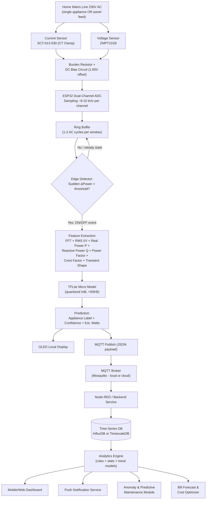

# THINK

**Instruction:** To strictly go through HTML file first and then Post a Question.

**Question:** How will we take the Data of home appliances from Sensors and How will we classify them? What is the Problem there?

### 1. The Core Concept

Here is the most important concept to understand: **The ESP-32 does NOT connect to your appliances digitally** (not via Wi-Fi, Bluetooth, or wires). It doesn't ask the fridge or the fan for their data.

Instead, the ESP-32 acts like a doctor with a stethoscope. It "listens" to the electricity flowing through the power wire, and it guesses which appliance is running based on the "sound" (the electrical fingerprint) of that electricity. This concept is called **Non-Intrusive Load Monitoring (NILM)**.

Here is a full, simple explanation of the Data Taking Part.

#### 1. How does it physically "take" the data?
You only need two sensors connected to your ESP-32 to read the electricity:

*   **The CT Clamp (Current Sensor - SCT-013):** This is the magic part. It looks like a plastic clip (like a clothespin with a hole in the middle). You simply clip this around the live power wire. You don't even need to cut the wire or strip the plastic off. As electricity flows through the wire to power an appliance, it creates a tiny magnetic field. The CT clamp reads this magnetic field to measure exactly how much current is being pulled.
*   **The Voltage Sensor (ZMPT101B):** This plugs directly into the socket (like a normal plug) to measure the voltage (which is usually a steady 230V in India).

> The ESP-32 takes the readings from both of these sensors very fast (around 8,000 times a second).

#### 2. How does it identify the appliance? (The Fingerprint)
Every appliance "drinks" electricity in a unique way:

*   **A Heater (Geyser/Kettle)** drinks electricity smoothly and constantly.
*   **A Fridge (Motor/Compressor)** takes a huge, sudden gulp of electricity when it first turns on, then settles down.
*   **A Laptop Charger** takes electricity in sharp, weird little spikes.

Because the ESP-32 is reading the electricity 8,000 times a second, it sees the exact "shape" of how the electricity is being consumed. **This shape is the fingerprint.** The ML (Machine Learning) model inside the ESP-32 has been trained to look at this shape and say: *"Ah, that sudden huge gulp of power looks exactly like a Fridge starting up."*

#### 3. How many devices can one ESP-32 connect to?
Since it doesn't digitally pair with devices, the number of appliances it can monitor depends on **where you clip the CT Clamp**.

As mentioned in Section 11.1 of the Implementation plan, you have two choices for your project:

**Option A: One Device per Circuit / Socket (Recommended for your working project)**
You clip the sensor around the wire of a single extension board or a single wall socket.
*   **How many appliances?** It will monitor whatever is plugged into that specific socket (e.g., 1 to 4 devices).
*   **Why do this?** It is highly accurate (90%+). When the fridge turns on, the signal is loud and clear. This is the best way to prove your project works to examiners. To cover a whole house this way, you would need multiple ESP-32s (one for every room or major appliance).

**Option B: Whole-Panel True NILM (The "Holy Grail")**
You clip the sensor around the Main Power Wire right at the central circuit breaker (MCB) box of the house.
*   **How many appliances?** It monitors the entire house (every single appliance) with just ONE single ESP-32.
*   **The Catch:** This is a very difficult Machine Learning problem. If the Fridge, AC, TV, and 4 Fans are all running at the exact same time, their electrical "sounds" all mix together into one noisy mess. The ML model has to be extremely smart to untangle that mess and realize exactly what is running. This is a PhD-level research problem.

#### Summary of the Data Flow
1.  Appliance turns on.
2.  Electricity flows through the home's wire.
3.  CT Clamp (clipped around the wire) feels the magnetic field of the electricity.
4.  ESP-32 reads the CT clamp 8,000 times a second to see the "shape" of the electricity.
5.  ESP-32's ML Model looks at the shape and identifies the appliance.
6.  ESP-32 sends a message over Wi-Fi: *"Fridge just turned on and is using 150 Watts."*

---

**Now Posts a Problem:** When we will attach the sensors in the main MCP, there is a very high chance the ML model may fail. Then we need to add some more optimized techniques to classify the signals.

### Advanced Signal Processing & True NILM (Option B) Architecture

If you are committing to **Option B (Whole-Panel True NILM)**, you are moving from a simple classification project to a highly advanced signal disaggregation problem. This is a fantastic challenge that will make your project stand out heavily.

Because multiple appliances will be running at the exact same time, their electrical "sounds" (waveforms) will mix together. Here is a deep dive into the techniques you will need to untangle that mix, starting with FFT and moving to advanced methods not mentioned in the HTML.

#### 1. What FFT Actually Does Explained (The Basics)
The HTML mentions FFT in Step 4 ("Firmware (C++) in numbers pe Fast Fourier Transform (FFT) lagata hai"). Here is exactly what it does and why it is used.

*   **The Concept:** When electricity flows, it travels as a sine wave at 50Hz (in India). 
    *   A simple heater draws power in a perfect 50Hz sine wave. 
    *   When a complex appliance (like a TV or Laptop Charger) uses power, it contains an SMPS (Switched-Mode Power Supply). These chop up the electricity, causing the wave to distort.
    *   This distortion creates "echoes" at higher frequencies (150Hz, 250Hz, 350Hz, etc.), which are called **Harmonics**.
        *   Fundamental Frequency: 50Hz
        *   3rd Harmonic: 150Hz
        *   5th Harmonic: 250Hz
        *   7th Harmonic: 350Hz
*   **The Execution:** FFT takes the messy, distorted wave and separates it into individual frequency buckets. It creates a mathematical "Harmonic Fingerprint" (e.g., this wave is 100 units of 50Hz + 45 units of 150Hz + 10 units of 250Hz). This fingerprint is what the ML model uses to identify the appliance.

#### 2. Why FFT Alone Is Not Enough for Option B
If you are doing Option B (Whole-Panel), multiple appliances will be running at the exact same time. Their harmonics will mix together, which will confuse a simple ML model. To make Option B successful, you must add these advanced techniques (not mentioned in the HTML):

*   **A. Real vs. Reactive Power (P and Q):** Not all power is "used" by the appliance. Motors (like Fridges, Fans, ACs) create a magnetic field, which causes a lag between the voltage and current waves. 
    *   **Real Power (Watts):** The power actually doing the work.
    *   **Reactive Power (VAR):** The power bouncing back and forth to maintain the magnetic field.
    *   *How to use it:* Plotting Real Power vs. Reactive Power on an X-Y graph perfectly separates Resistive appliances (Geyser) from Inductive appliances (Fridge/Fan). This is the most standard technique in NILM research.
*   **B. V-I Trajectory (Voltage-Current Shape):** Instead of looking at a current wave over time, you plot Voltage against Current on an X-Y graph for one single AC cycle. 
    *   A heater creates a perfect straight diagonal line.
    *   A laptop charger creates a weird "bat-wing" or circular shape.
    *   *How to use it:* You can treat this 2D shape like an image and feed it into a Convolutional Neural Network (CNN) for highly accurate recognition. This is extremely robust even when multiple appliances are mixed.
*   **C. Transient (Startup) Analysis (Crucial!):** This is the secret weapon for Option B. When an appliance turns on (like a Fridge compressor), it creates a massive, unique spike of current for about 0.5 seconds before settling down.
    *   *How to use it:* Your ESP-32 should use an "Edge Detection" algorithm to monitor total power. If total power suddenly jumps by 400W, the ESP-32 captures the exact shape of just this 0.5-second spike and feeds that isolated event to the ML model, rather than trying to untangle the messy steady-state signal. The transient spike is almost impossible to confuse with anything else.

#### 3. Machine Learning for Whole-Panel (Option B)
In Option A, you just needed a simple Multi-Layer Perceptron (MLP). For Option B, you are doing **Disaggregation**. If the total house is drawing 1200W, the ML has to split it: `1200W = 800W (AC) + 300W (Fridge) + 100W (TV)`. You will need to upgrade your ML approach:

*   **Approach 1: Event-Based Classification (Recommended for B.Tech)**
    1.  The ESP-32 tracks the total baseline power.
    2.  It detects a sudden "step up" (Event).
    3.  It subtracts the old baseline from the new signal to isolate the *change*.
    4.  It extracts FFT, Real/Reactive Power, and Transient shape from the change.
    5.  It runs a classifier to say: "The thing that just turned on is the Fridge."
    6.  It adds the Fridge to the "Currently ON" list in your backend.
    7.  When it detects a "step down", it matches it to the currently ON appliances and removes it.
*   **Approach 2: Deep Sequence Models (Advanced)**
    *   Instead of extracting features manually, you feed a continuous window of the raw Current waveform into a 1D-CNN (Convolutional Neural Network) or an LSTM (Recurrent Neural Network). The AI learns the patterns itself.
    *   **Pros:** State-of-the-art accuracy for True NILM.
    *   **Cons:** Very hard to fit on an ESP-32. You might need to send the raw data to a Raspberry Pi or Cloud Server to run the model.

#### 4. How Your Revised Roadmap Changes for Option B
Going with Option B elevates this from a standard B.Tech project to a PhD-level research problem (True Disaggregation).

*   **Month 1 (Data Collection is Harder):** You can't just plug one appliance in at a time. You have to connect the ESP-32 to the main panel and log exactly when you turn different combinations of appliances on and off to train the model on the "mixed" signals (to create your "Ground Truth" labels).
*   **Month 2 (Disaggregation Algorithm):** You will likely need to use Python and existing open-source NILM toolkits (like NILMTK) to train your model. NILMTK has built-in algorithms specifically for untangling whole-house data.
*   **Month 3 (Hardware Limits - Edge vs Cloud):** Disaggregating mixed signals is mathematically heavy. You may find that the ESP-32 is not powerful enough to run the ML model. 
    *   **Pivot plan:** A very common architecture is to have the ESP-32 only do Steps 1-4 (Sampling and Feature Extraction/FFT), but send the data over Wi-Fi to a local laptop or Raspberry Pi to run the Heavy ML model to do Step 5 (Disaggregation). This is a completely valid and impressive architecture.

---

# Implementation Plan: Power Line Fingerprinting (NILM)
### "Bijli ka X-Ray Machine" — Non-Intrusive Load Monitoring System

---

## 0. Read of the Existing Concept Note (HTML)

Before the plan, here's what your HTML already establishes well, so we don't repeat it:
- **Pitch**: single ESP32-based device that identifies which appliance is running from the aggregate electrical signal — no rewiring, no per-appliance smart plugs.
- **3 problems**: opaque bills, appliances left ON (safety + waste), high cost of commercial smart-home metering.
- **Pipeline shown**: Wall socket → ZMPT101B → ESP32 ADC → FFT (firmware) → TFLite Micro model → OLED/dashboard.
- **Roadmap shown**: Month 1 hardware+data, Month 2 ML training, Month 3 deployment.

This is a genuinely good skeleton. The gap isn't vision — it's **execution precision**: exact parts, exact datasets, exact model architecture, exact evaluation criteria, and (critically) one architectural decision the current note glosses over. That decision is covered in detail in **Section 11.1** — read it before you start Month 1, because it determines your hardware BOM.

---

## 1. What "Done" Looks Like

A device that:
1. Clips onto a **single mains line** (either one appliance's cord, or the main panel feed — decision in 11.1) via a non-invasive current sensor.
2. Samples voltage + current at ≥8 kHz, extracts a spectral/harmonic "fingerprint" every ON/OFF event.
3. Runs a quantized on-device model that classifies the fingerprint into one of 6+ known appliance classes with ~90%+ accuracy.
4. Streams results (appliance, estimated wattage, timestamp) over Wi-Fi/MQTT to a backend.
5. Powers a dashboard/app that doesn't just show "what's on" but produces **actionable intelligence** (Section 8) — this is what separates it from a generic IoT project.

---

## 2. System Architecture (Full Flow)



**Why this differs from the HTML's version**: the original stepper shows only ZMPT101B (voltage). I've added the **SCT-013 current sensor** as a parallel path feeding the same ADC. Reasoning is in 11.1 — short version: voltage barely changes between appliances (it's always ~230V sine), so a classifier trained on voltage-only harmonics is really learning noise. **Current draw shape is the actual fingerprint.** Real NILM literature (Hart 1992 onward, and every public dataset below) always uses current/power, and typically voltage×current for real+reactive power.

---

## 3. Hardware Bill of Materials (Detailed)

| Component | Purpose | Approx. Cost (INR) | Notes |
|---|---|---|---|
| ESP32 DevKit V1 (dual-core, WiFi) | Main compute + ADC sampling | ₹350–450 | Use built-in ADC1 (ADC2 conflicts with WiFi) |
| SCT-013-030 CT clamp (30A/1V) | **Non-invasive current sensing** | ₹250–350 | Clips around live wire, no rewiring — this is the actual "fingerprint" sensor |
| ZMPT101B module | Voltage waveform + zero-crossing reference | ₹100–150 | Needed for real/reactive power calc, not for classification alone |
| Burden resistor (33Ω–100Ω, calc'd for your CT) | Converts CT current to safe voltage | ₹10 | Formula in 5.2 |
| Op-amp bias circuit (or use a bias board) | Shifts AC signal to 0–3.3V ADC range | ₹50 | Needed since ESP32 ADC can't read negative voltage |
| 0.96" OLED (SSD1306, I2C) | Local readout | ₹150 | Optional but nice for demo |
| MicroSD module + card | Raw data logging during Month 1 | ₹150 | Essential for offline dataset building |
| Enclosure + jumper wires + breadboard/perfboard | Housing | ₹200 | — |
| **Total prototype cost** | | **~₹1,300–1,600** | Higher than the ₹650 quoted in the HTML because that number assumed voltage-only sensing |

> ⚠️ **Safety note to put in your report**: any circuit touching mains voltage (the ZMPT101B and CT primary side) must go through proper isolation. The CT clamp is inherently non-invasive/isolated (that's its whole point), but document this safety reasoning explicitly in your report — examiners will ask, and it's a genuine safety-critical detail for a device plugged into mains.

---

## 4. Data Collection Plan (Month 1 — Detailed)

### 4.1 Appliance Selection (pick 6, as in your note)
Choose appliances with **clearly different electrical signatures** for your first working version:
1. **Resistive, steady** — Electric kettle / Iron (pure resistive load, power factor ≈1, no harmonics)
2. **Resistive with thermostat cycling** — Geyser / Water heater (relevant to your "left ON" alert use case)
3. **Inductive motor, steady** — Refrigerator (compressor, characteristic startup current spike — 3-5x running current)
4. **Inductive motor, variable** — Ceiling fan or Washing machine motor
5. **Switched-mode power supply (SMPS)** — Laptop charger / Phone charger (highly non-linear, sharp harmonic peaks — good for "phantom load" detection story)
6. **Complex/electronic load** — LED TV or Microwave (microwave especially has a distinctive magnetron startup transient)

This spread deliberately covers: resistive, inductive-motor, and SMPS load types — the three fundamental categories in NILM literature. Pick **maximally different types**, not 6 random gadgets, or your classifier will struggle to separate similar ones (e.g., don't pick 3 different phone chargers).

### 4.2 Collection Protocol
- For each appliance, collect **≥500 labeled events** minimum (your HTML's number is right), split as:
  - ~150 ON-transient captures (the spike/rise pattern)
  - ~150 steady-state windows (mid-operation)
  - ~150 OFF-transient captures
  - ~50 "combined with 1 other known appliance running" (start easy: even this small set will reveal how hard multi-load disaggregation is — see 11.1)
- Log to microSD as CSV: `timestamp, raw_current_adc[], raw_voltage_adc[], label`
- Also log **environmental metadata**: which other appliances were on, time of day, voltage sag events (India's grid has real voltage fluctuation — your model needs some robustness to this).
- **Where to get data if your own collection falls short of a full month**: supplement / pretrain / validate against public NILM datasets:
  - **PLAID** (Plug Load Appliance Identification Dataset) — event-based, per-appliance current/voltage waveforms, closest in spirit to your single-appliance approach. Free, academic.
  - **WHITED** (World-wide Household and Industry Transient Energy Data) — high-res transient captures per appliance, great for startup-transient features.
  - **REDD** (Reference Energy Disaggregation Dataset) and **UK-DALE** — whole-house panel-level data with per-circuit ground truth. Use these ONLY if you go the panel-level (harder) route in 11.1.
  - Use these to (a) validate your feature extraction pipeline before your own hardware is ready, and (b) pretrain a model you then fine-tune on your own 6 appliances — this derisks Month 1 if hardware bring-up slips.

### 4.3 Dataset Structure (deliverable of Month 1)
```
/data
  /fridge/      fridge_001.csv ... fridge_500.csv
  /geyser/      ...
  /kettle/      ...
  /charger/     ...
  /fan/         ...
  /microwave/   ...
  /combined/    fridge_and_charger_001.csv ...
  metadata.json   (collection conditions, sampling rate, appliance ratings)
```

---

## 5. Signal Processing & Feature Engineering (Month 1-2 bridge)

### 5.1 Sampling
- Sample **both channels** (voltage + current) synchronously at ~8-10 kHz for at least 2 full AC cycles (2 × 20ms = 40ms window at 50Hz) per feature extraction.
- Use ESP32's `adc1_get_raw()` in a tight loop or better, the I2S ADC mode for consistent timing (avoids WiFi task jitter stealing your sampling loop).

### 5.2 Burden Resistor Calc (so your CT reads correctly)
```
Burden Resistor (Ω) = (Sensor Output Voltage Rating) / (Max Expected Current / Turns Ratio)
```
For SCT-013-030 (30A : 1V output, effectively 1800-turn ratio), a **33Ω resistor** typically gives a usable 0-1V range for home-appliance currents (0.5A-10A). Verify empirically with a known load (e.g., a 60W bulb) and a multimeter before trusting your dataset.

### 5.3 Feature Vector (what actually goes into the model)
Don't rely on raw FFT bins alone (your HTML's plan). Use this richer, standard NILM feature set:
- **Fundamental + harmonics 2nd-9th** (FFT magnitude at 50, 100, 150...450 Hz) — this is what your HTML already shows
- **RMS Current (I_rms)**
- **Real Power (P)** = mean(V(t) × I(t))
- **Apparent Power (S)** = V_rms × I_rms
- **Reactive Power (Q)** = √(S² − P²)
- **Power Factor (PF)** = P/S — huge discriminator: resistive loads (kettle, iron) ≈1.0, motors ≈0.6-0.85, SMPS often low and distorted
- **Crest Factor** = I_peak / I_rms — flags non-linear/SMPS loads
- **Turn-on transient shape** (first 200ms current envelope) — very distinctive for motors (inrush spike) vs resistive (flat step)

This gives a feature vector of ~15-20 numbers per event instead of just 6 harmonic bins — meaningfully more separable classes, and still tiny enough for a microcontroller.

---

## 6. ML Model Plan (Month 2 — Fully Detailed)

### 6.1 Tooling
- **Language/Framework**: Python 3.10+, TensorFlow 2.x / Keras (has the most mature TFLite Micro export path)
- **Environment**: Google Colab (free GPU) or local laptop — dataset is small (~3000-4000 events × 20 features), doesn't need serious compute
- **Libraries**: `numpy`, `pandas`, `scipy.fft`, `scikit-learn` (for train/test split, confusion matrix, StandardScaler), `tensorflow`

### 6.2 Data Pipeline
1. Load CSVs → parse raw ADC arrays
2. Run the Section 5.3 feature extraction in Python (mirrors what firmware will eventually do in C — write it once in Python for training, port to C for inference)
3. Normalize features (StandardScaler — **save the mean/std, you'll hardcode these into firmware** since ESP32 can't run sklearn)
4. Split: 70% train / 15% validation / 15% test, **stratified by appliance**, and make sure events from the same physical session don't leak across splits (else you'll get falsely high accuracy)

### 6.3 Model Architecture
Start simple, only add complexity if accuracy demands it:
- **Baseline**: Random Forest / SVM on the 20-feature vector — do this FIRST, in an afternoon. It gives you a sanity-check accuracy number and tells you if your features are even separable, before you spend a week on neural net tuning.
- **Actual deployed model**: Small MLP (Dense NN):
  ```
  Input (20 features) 
    → Dense(32, relu) 
    → Dense(16, relu) 
    → Dense(7, softmax)   # 6 appliances + "unknown/no event"
  ```
  This is intentionally tiny — NILM feature vectors are low-dimensional and well-separated once you have power/PF/crest-factor, so a deep/wide network usually overfits your ~3000-sample dataset rather than helping.
- **If you have time/ambition**: try a small 1D-CNN directly on the raw current waveform (40ms window, ~320-400 raw samples) instead of hand-crafted features — this is closer to how modern NILM papers do it, and is a good "stretch goal" to mention in your report as future work even if you ship the MLP version.

### 6.4 Training & Evaluation
- Loss: categorical cross-entropy, Adam optimizer, ~50-100 epochs with early stopping on validation loss
- **Report a confusion matrix, not just accuracy** — for a project report, examiners care whether your errors are "sensible" (e.g., fan confused with washing machine — both motors) vs random.
- Target: ~90%+ per-event accuracy on held-out test set for the 6-class single-appliance case (this is realistic based on public NILM benchmarks for a well-separated appliance set).
- **Explicitly test the "combined" data** (two appliances on at once) even if you don't solve disaggregation — report the accuracy drop honestly. This becomes a strength in your report: "we identified and quantified the multi-load disaggregation limitation" is a more impressive statement than pretending it doesn't exist.

### 6.5 Quantization & Export
```python
converter = tf.lite.TFLiteConverter.from_keras_model(model)
converter.optimizations = [tf.lite.Optimize.DEFAULT]
converter.representative_dataset = representative_data_gen  # for full int8 quantization
converter.target_spec.supported_ops = [tf.lite.OpsSet.TFLITE_BUILTINS_INT8]
converter.inference_input_type = tf.int8
converter.inference_output_type = tf.int8
tflite_model = converter.convert()
```
- Target: **<50KB** `.tflite` file (a 32-16-7 MLP int8-quantized will comfortably be under 10KB — you have a lot of headroom, don't over-worry about size for this architecture)
- Convert to a C byte array: `xxd -i model.tflite > model_data.cc`

---

## 7. Firmware / Edge Deployment (Month 3, first half)

1. Add **TensorFlow Lite for Microcontrollers** library via Arduino/ESP-IDF (Arduino_TensorFlowLite or esp-tflite-micro)
2. Port the exact same feature extraction math from Section 5.3 into C++ (this is the step most students under-budget time for — validate each feature's C output against the Python output on the same raw sample, don't assume it matches)
3. Hardcode the normalization constants (mean/std from training) into firmware
4. Implement the event-detector (Section 8's "Edge Detector" node) so you're not running inference continuously — only on ON/OFF transitions. This saves power and avoids spurious mid-cycle predictions.
5. Inference loop: capture window → extract features → normalize → `interpreter.Invoke()` → get class + confidence
6. If confidence < threshold (e.g., 60%), display "Unknown appliance" rather than a wrong guess — this single UX decision massively improves perceived reliability in a demo.

---

## 8. Backend, App & Analytics (Month 3, second half)

- **Transport**: ESP32 publishes JSON over MQTT (`{"appliance":"fridge","watts":150,"confidence":0.94,"ts":...}`) to a local Mosquitto broker (or a free cloud MQTT broker like HiveMQ for the demo)
- **Orchestration**: Node-RED (matches your HTML's Month 3 plan) for quick flows: MQTT-in → DB write → notification rules — fastest way to get a working demo without writing a custom backend
- **Storage**: InfluxDB (purpose-built for time-series/IoT data, free tier is plenty) or a simple Postgres/TimescaleDB if you want SQL familiarity for your report
- **Dashboard**: Node-RED Dashboard nodes for MVP; or a simple React/Next.js app + charts (Recharts) if you want a more "product" feel for your final demo
- **Notifications**: simple webhook to Telegram Bot API or a free push service (like ntfy.sh) — much faster to implement than building native mobile push infra for a 3-month project

---

## 9. The Intelligence Layer — What to Show the User (Top to Bottom)

This is where your project stops being "an IoT gadget" and becomes genuinely differentiated. Organize your final report/demo around these **tiers**:

### Tier 1 — Basic Reporting (table stakes, every smart plug does this)
- Real-time "what's on right now" view
- Per-appliance kWh and ₹ breakdown (daily/weekly/monthly)
- Historical usage graphs per appliance

### Tier 2 — Behavioral Alerts (solves your Problem #2 directly)
- **"Left ON" detection**: learn each appliance's *typical* max-duration-per-session (e.g., geyser usually runs 15-20 min), alert when it exceeds 2-3x that baseline
- **Phantom/standby load detection**: SMPS chargers left plugged in but device removed — flag continuous small draw as wasted "vampire power"
- **Unexpected-hours alert**: appliance running at a time it's never run before (e.g., iron at 2 AM) — useful safety/security signal, not just efficiency

### Tier 3 — Predictive & Comparative Intelligence (this is the genuinely novel part — lean into this in your report)
- **Bill forecasting**: given first-half-of-month usage trend per appliance, project end-of-month bill *before the bill arrives* — directly solves the "blind bill" problem, and no competing consumer product does this per-appliance
- **Appliance health / predictive maintenance**: track an appliance's current-draw signature (esp. compressor/motor loads like fridge, AC) *over weeks/months*. A rising current draw for the same duty cycle, or a shift in the harmonic profile, is a known early indicator of motor wear or refrigerant issues — you can flag "your fridge's power draw has risen 12% over 3 weeks, consider servicing" **before it fails**. This is the single feature that would most impress an examiner or recruiter, because it uses the ML fingerprint for something beyond classification.
- **Comparative benchmarking**: "your fridge (X liters) uses Y% more energy than typical fridges of this size" — requires a small reference table of typical appliance consumption by category/rating, easy to source and hardcode
- **Duty-cycle efficiency scoring**: for thermostatic loads (fridge, geyser, AC), compute ON-time/OFF-time ratio over a day; a rising ON-ratio at constant ambient conditions suggests declining efficiency (worn door seal on fridge, scale buildup in geyser, etc.)

### Tier 4 — Optimization & Automation (stretch goals, good "future work" section)
- **Cost optimization**: if the user is on a time-of-day tariff, recommend shifting flexible loads (washing machine, geyser) to off-peak hours
- **Carbon footprint estimate**: convert kWh to CO₂-equivalent using grid emission factor (available from India's CEA reports) — nice sustainability angle for the report
- **Natural-language query interface**: "How much did my AC cost me last week?" — a thin LLM wrapper over your structured time-series data (this is very achievable now and makes for a great demo moment)
- **Auto-control** (only if you add a relay): auto-cutoff for "left on" appliances after user-configurable timeout

---

## 10. Step-Wise Roadmap (Detailed, Week-by-Week)

### Month 1 — Hardware & Data
| Week | Deliverable | Detail |
|---|---|---|
| 1 | Breadboard circuit: ESP32 + ZMPT101B + SCT-013 + bias circuit | Validate with oscilloscope/multimeter that ADC readings track a known load (e.g., 60W bulb) sensibly before trusting anything downstream |
| 2 | Firmware: dual-channel sampling + microSD CSV logging | Confirm sample rate is actually consistent (log timestamps, check for WiFi-induced jitter) |
| 3 | Collect data for 3 appliances (kettle, fridge, charger) | Follow protocol in 4.2; also pull PLAID/WHITED data in parallel as backup/validation set |
| 4 | Collect remaining 3 appliances + combined-load samples | Deliverable: full `/data` folder as in 4.3, plus a short write-up of any sensor calibration issues found |

### Month 2 — ML Training
| Week | Deliverable | Detail |
|---|---|---|
| 5 | Python feature-extraction pipeline (Section 5.3) mirrored on your real data | Sanity-check features visually (plot PF and crest-factor per class — they should already look separable) |
| 6 | Baseline model (Random Forest) + confusion matrix | This is your accuracy floor; if this is bad, fix data/features before touching neural nets |
| 7 | MLP model training, tuning, evaluation on held-out + combined-load test set | Target ≥90% single-appliance accuracy; document combined-load accuracy honestly |
| 8 | Quantize to TFLite int8, export C array, unit-test inference in a standalone Python script against known samples | Deliverable: `model_data.cc` + a report table of accuracy/size/latency |

### Month 3 — Deployment & Product
| Week | Deliverable | Detail |
|---|---|---|
| 9 | Port feature extraction to C++, integrate TFLite Micro, validate on-device predictions match Python | This is the highest-risk week — budget extra buffer here |
| 10 | MQTT publishing + Node-RED flow + InfluxDB storage working end-to-end | Deliverable: live data flowing from device to a database |
| 11 | Dashboard (Node-RED Dashboard or simple web app) + Tier 1 & Tier 2 intelligence features (Section 9) | Alerts (left-on, phantom load) should be demoable |
| 12 | Polish, Tier 3 feature (pick at least bill forecasting — highest impact, lowest effort), final demo run-through, report writing | Rehearse the live demo end-to-end at least 3 times before submission day |

---

## 11. My Analysis — Gaps, Risks, and Recommendations

### 11.1 ⚠️ The Central Architectural Decision the Current Note Skips
Your HTML says (Problem #3) the device is a **"central device [that] monitors the whole building"** — i.e., installed once at the mains panel, identifying every appliance in the house from one vantage point. This is **true NILM** (the hard, real research problem — appliance signal disaggregation from an aggregate signal with many things running simultaneously).

But the Month 1-3 roadmap and data collection plan (collect clean, one-appliance-at-a-time samples) describes building a **single-appliance classifier** — which is much easier, but only works well when installed **per appliance or per circuit**, not at a whole-panel level with multiple simultaneous loads.

**You need to explicitly choose one, because they lead to different projects:**

| | Option A: Per-Appliance / Per-Circuit Device | Option B: Whole-Panel True NILM |
|---|---|---|
| Difficulty | Achievable in 3 months, matches your roadmap | Genuinely hard even for PhD research; multi-load overlap makes classification accuracy drop sharply |
| Hardware | One clamp per monitored circuit/appliance | One clamp at the main panel |
| Story for Problem #3 (cost) | Weaker — you need multiple devices, though still cheaper than N smart plugs if it does circuits not appliances | Strong — literally one device |
| Recommendation | **Do this for your working prototype** | Mention as "future work / stretch goal" in your report, and optionally demo disaggregation qualitatively on 2 simultaneous appliances using the combined-data samples from 4.2 |

**My recommendation**: build Option A (per-appliance/circuit) as your real, working, demoable system — it's what your Month 1-3 plan actually supports — but position it in your report as "the same fingerprinting technique, scaled down to circuit-level for reliability; panel-level disaggregation of N simultaneous loads is the natural next step," and back that claim with the combined-load accuracy numbers from Section 6.4. This is honest, achievable, AND sounds more sophisticated than silently claiming whole-building coverage you haven't actually validated.

### 11.2 Voltage-Only Sensing Was Insufficient
Already addressed by adding the SCT-013 current sensor in Section 3 — flagging again here because it's the most important single change from your original HTML. Voltage waveform shape bares very little appliance-specific information (it's set by the grid, not the load); current waveform shape is where the actual fingerprint lives. Any version of this project without a current sensor will plateau at low accuracy no matter how good the model is.

### 11.3 "500 samples per appliance" Needs a Definition of "Sample"
Your HTML's target is good but ambiguous — is a "sample" one raw ADC reading, or one full ON-event? Section 4.2 above resolves this: **500 labeled events** (ON-transients + steady-state windows + OFF-transients), not raw readings. Worth being precise about this in your report since it directly affects how "achievable" the number sounds to an evaluator.

### 11.4 Underused Opportunity: Predictive Maintenance
The single highest-value addition to this project, and the one I'd most emphasize in interviews/resume, is **Section 9, Tier 3's predictive maintenance angle**. Almost every student NILM project stops at "identify + measure." Tracking the *drift* of an appliance's signature over weeks (rising current draw, changing power factor, longer duty cycles) to predict maintenance needs is a genuinely under-explored consumer application of NILM data, is cheap to add (it's just a trend analysis on data you're already collecting), and turns your project from "cool classifier" into "the sensor infrastructure enables predictive intelligence" — a much stronger narrative.

### 11.5 Report/Demo Risk: Firmware Port Mismatch
The single most common failure mode in projects like this is: Python model gets 92% accuracy in Colab, but the ESP32 version gets 60%, because the hand-ported C++ feature extraction doesn't exactly match the Python version (off-by-one in windowing, different FFT library conventions, quantization scale mismatches). Budget explicit time (Week 9 above) to unit-test each feature function in isolation, comparing C output to Python output on the *same* recorded raw sample, before trusting end-to-end on-device accuracy numbers.

### 11.6 Additional Intelligence Ideas Beyond Section 9 (for brainstorming / future work)
- **Multi-user/multi-plug fleet learning**: if you (or classmates) deploy multiple units, pool anonymized appliance signatures to build a better generalized model — a light "federated learning" story is a nice differentiator for a resume bullet.
- **Seasonal baseline adjustment**: fridge/AC duty cycles shift with ambient temperature — a naive "usage went up" alert should account for weather, not just flag every summer AC increase as anomalous.
- **Grid health signal**: since you're already sampling voltage at high resolution, you get voltage sag/surge/frequency-deviation data "for free" — could power a secondary "power quality monitor" feature (interesting to mention, low extra effort).

---

## 12. Resume / Report Framing (from your HTML's closing section, sharpened)

When describing this project, the strongest one-line framing is:
> "Designed and built an edge-AI (TinyML) system for non-intrusive appliance load monitoring — from analog sensor circuit design through quantized on-device neural network inference to a predictive analytics dashboard, achieving ~90%+ classification accuracy on a self-collected dataset."

Skills this genuinely demonstrates (all defensible in an interview because you actually built them per this plan): embedded systems (ESP32, ADC/sampling), analog signal conditioning (CT clamp, burden resistor, bias circuit), DSP (FFT, feature engineering), applied ML (model design, quantization, TFLite Micro), IoT backend (MQTT, time-series DB), and product thinking (the Tier 1-4 intelligence layer, not just "it works").

---

## Appendix: Reference Datasets & Tools
- **PLAID**: https://plaidplug.com/ — per-appliance current/voltage event data
- **WHITED**: transient-focused per-appliance dataset
- **REDD** / **UK-DALE**: whole-house panel-level datasets (only needed if pursuing Option B in 11.1)
- **TensorFlow Lite for Microcontrollers**: official TF docs + `esp-tflite-micro` Arduino/ESP-IDF component
- **Node-RED**: nodered.org — fastest path to a working MQTT→DB→Dashboard flow
- **InfluxDB**: time-series DB, free tier sufficient for a semester project
