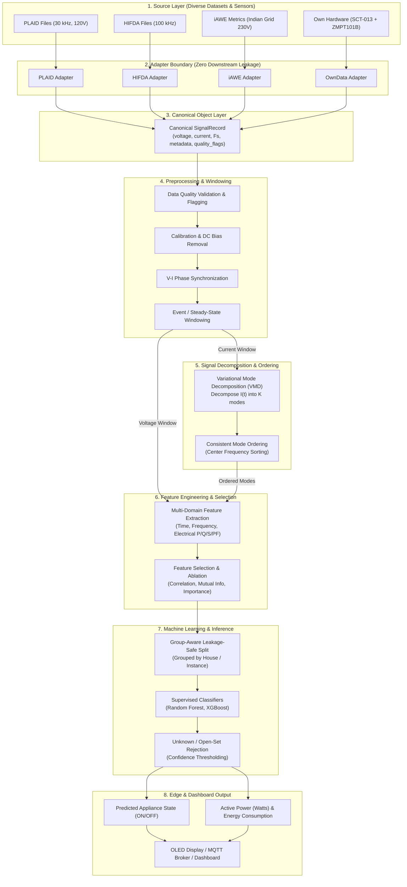

# Master Phase-Wise Implementation Plan — NILM / Power Consumption Analyzer
### *"Bijli ka X-Ray Machine"* — Complete Engineering Contract & Execution Roadmap

---

## Document Overview & Purpose

This document is the **authoritative, super-detailed implementation contract** for building the Non-Intrusive Load Monitoring (NILM) pipeline for the Power Consumption Analyzer project.

It unifies:
1. The **Phase-by-Phase Roadmap (Phase 0 through Phase 17)** from the foundational architecture.
2. The **Senior Engineer Architectural Guidance** regarding data fidelity, error exposure, and clean boundary separation.
3. The **Empirical Discoveries and Progress** achieved through Phase 0 and Phase 1 (verification of the 1,876 PLAID submetered records, 30 kHz sampling, $V/I$ representation, and diagnostic waveform analysis).
4. Concrete technical contracts, formulas, failure conditions, pass gates, and hard entry gates for every engineering stage.

---

## Table of Contents

1. [Non-Negotiable Engineering Rules](#1-non-negotiable-engineering-rules)
2. [Live State Machine & Project Progress Tracker](#2-live-state-machine--project-progress-tracker)
3. [Master System Architecture & Data Flow](#3-master-system-architecture--data-flow)
4. [Universal Data Contract & Missing Data Policy (Senior Engineer Mandate)](#4-universal-data-contract--missing-data-policy-senior-engineer-mandate)
5. [Detailed Phase-by-Phase Implementation Plans](#5-detailed-phase-by-phase-implementation-plans)
   - [Phase 0 — Project Contract and Pipeline Skeleton (PASSED)](#phase-0--project-contract-and-pipeline-skeleton-passed)
   - [Phase 1 — PLAID Dataset Ingestion & Universal Adapter (PASSED)](#phase-1--plaid-dataset-ingestion--universal-adapter-passed)
   - [Phase 2 — Raw Signal Validation & Preprocessing Policy (UNLOCKED / CURRENT)](#phase-2--raw-signal-validation--preprocessing-policy-unlocked--current)
   - [Phase 3 — Windowing & Event / Steady-State Representation](#phase-3--windowing--event--steady-state-representation)
   - [Phase 4 — Variational Mode Decomposition (VMD) Implementation](#phase-4--variational-mode-decomposition-vmd-implementation)
   - [Phase 5 — Consistent Mode Ordering (Semantic Mode Alignment)](#phase-5--consistent-mode-ordering-semantic-mode-alignment)
   - [Phase 6 — Multi-Domain Feature Extraction](#phase-6--multi-domain-feature-extraction)
   - [Phase 7 — Feature Selection, Correlation & Ablation Analysis](#phase-7--feature-selection-correlation--ablation-analysis)
   - [Phase 8 — Leakage-Safe Train / Validation / Test Group Splitting](#phase-8--leakage-safe-train--validation--test-group-splitting)
   - [Phase 9 — Random Forest & XGBoost Baseline Modeling](#phase-9--random-forest--xgboost-baseline-modeling)
   - [Phase 10 — Empirical Proof: Does VMD Actually Add Value?](#phase-10--empirical-proof-does-vmd-actually-add-value)
   - [Phase 11 — HIFDA Cross-Dataset High-Frequency Validation](#phase-11--hifda-cross-dataset-high-frequency-validation)
   - [Phase 12 — iAWE Indian Household Context Baseline](#phase-12--iawe-indian-household-context-baseline)
   - [Phase 13 — Unknown & Unseen Appliance Rejection Evaluation](#phase-13--unknown--unseen-appliance-rejection-evaluation)
   - [Phase 14 — Own Hardware Sensor Adapter (SCT-013 & ZMPT101B)](#phase-14--own-hardware-sensor-adapter-sct-013--zmpt101b)
   - [Phase 15 — Real-Data Revalidation & Domain Shift Adaptation](#phase-15--real-data-revalidation--domain-shift-adaptation)
   - [Phase 16 — Edge Deployment Pipeline (Raspberry Pi / ESP32 Equivalence)](#phase-16--edge-deployment-pipeline-raspberry-pi--esp32-equivalence)
   - [Phase 17 — Final End-to-End System Validation & Demonstration](#phase-17--final-end-to-end-system-validation--demonstration)
6. [Master Phase Summary Matrix](#6-master-phase-summary-matrix)

---

## 1. Non-Negotiable Engineering Rules

Every developer, automated tool, or coding agent working on this repository must strictly adhere to the following rules:

1. **Strict Phase-by-Phase Execution**:
   - Never advance to a subsequent phase if the previous phase has not passed its **PASS GATE**.
   - If any prerequisite is missing, ambiguous, broken, or unverified: **STOP**, state the exact failure, and request or produce the required artifact.
2. **Never Silently Fabricate Data**:
   - Missing fields (brand, wattage, serial number, session ID) must remain `None`/missing.
   - Missing channels (e.g., voltage missing) must never be substituted with artificial 120V or 230V sine waves.
   - Corrupted signals (NaN, Inf, clipping) must be exposed via explicit quality flags, not silently interpolated.
3. **No Downstream Format Leakage**:
   - Signal processing, VMD, feature extraction, and ML models must interact **only** with the canonical `SignalRecord` dataclass.
   - Code outside `datasets/` must never read raw CSV files, expect specific dataset directory layouts, or hardcode column names.
4. **Never Globally Hardcode Sampling Rate or Window Length**:
   - Do not assume universal constants like $F_s = 10\text{ kHz}$ or $F_s = 30\text{ kHz}$.
   - Do not hardcode "400 samples = one event". Sample counts must always be derived dynamically:
     $$\text{samples} = F_s \times \text{duration}$$
5. **Strict Decoupling of Features and Labels**:
   - Ground truth ($Y$) must never enter the feature vector ($X$).
6. **VMD is an Empirical Hypothesis, Not an Axiom**:
   - VMD must not become a mandatory production dependency until Phase 10 proves with statistical rigor that it outperforms a non-VMD baseline.

---

## 2. Live State Machine & Project Progress Tracker

The current status of each phase in our codebase:

```text
[✅ PASSED]   PHASE 0  — Project Contract & Pipeline Skeleton
[✅ PASSED]   PHASE 1  — PLAID Dataset Ingestion & Universal Adapter
[✅ PASSED]   PHASE 2  — Raw Signal Validation & Preprocessing Policy
[✅ PASSED]   PHASE 3  — Windowing & Event / Steady-State Representation
[✅ PASSED]   PHASE 4  — Variational Mode Decomposition (VMD) Implementation
[✅ PASSED]   PHASE 5  — Consistent Mode Ordering
[✅ PASSED]   PHASE 6  — Multi-Domain Feature Extraction
[✅ PASSED]   PHASE 7  — Feature Selection & Ablation Analysis
[✅ PASSED]   PHASE 8  — Leakage-Safe Train / Validation / Test Group Split
[🔓 UNLOCKED] PHASE 9  — Random Forest & XGBoost Baselines (CURRENT)
[🔒 LOCKED]   PHASE 10 — Empirical VMD Value Proof
[🔒 LOCKED]   PHASE 11 — HIFDA Cross-Dataset Validation
[🔒 LOCKED]   PHASE 12 — iAWE Indian Household Context Baseline
[🔒 LOCKED]   PHASE 13 — Unknown Appliance Rejection Evaluation
[🔒 LOCKED]   PHASE 14 — Own Sensor Adapter (SCT-013 + ZMPT101B)
[🔒 LOCKED]   PHASE 15 — Real-Data Revalidation & Domain Shift Adaptation
[🔒 LOCKED]   PHASE 16 — Edge Deployment Pipeline (Raspberry Pi / ESP32)
[🔒 LOCKED]   PHASE 17 — Final End-to-End System Validation
```

---

## 3. Master System Architecture & Data Flow



---

## 4. Universal Data Contract & Missing Data Policy (Senior Engineer Mandate)

### 4.1 The Core Contract: `SignalRecord`
Located at `ML/datasets/base.py`, the universal container holds:
* `signal_id`: Unique identifier (e.g. `"PLAID_1"`).
* `source_dataset`: String provenance identifier (`"PLAID"`, `"HIFDA"`, `"IAWE"`, `"OWN"`, `"SYNTHETIC"`).
* `recording_id`: Original source ID.
* `sampling_rate_hz`: Explicit positive float (strictly $> 0$).
* `appliance_label`: Ground truth string or `None` (strictly separated from features).
* `appliance_instance_id`: Physical device instance or `None`.
* `voltage`: 1D NumPy float array in Volts, or `None`.
* `current`: 1D NumPy float array in Amperes, or `None`.
* `metadata`: Contextual dictionary containing `location`, `quality_flags`, `expected_duration`, etc.

### 4.2 Handling Missing and Unreliable Data (Senior Engineer Mandate)
> **Rule:** Never fix, interpolate, or fabricate missing or bad data inside an Adapter. The adapter's sole responsibility is to *faithfully read, preserve, and expose* the raw data. Preprocessing and feature extraction make the decisions on repair vs. rejection.

#### The 4 Defect Categories:
1. **Type A — Missing Optional Metadata** (`brand=""`, `wattage=""`):
   - *Adapter*: Preserves as `None`.
   - *Downstream*: Signal processing proceeds normally without error.
2. **Type B — Missing Appliance Label** (`appliance.type=""`):
   - *Adapter*: Preserves as `None`, sets `quality_flags["label_missing"] = True`.
   - *Downstream*: Excluded from supervised training, but preserved for unsupervised inspection.
3. **Type C — Missing Signal Channel** (e.g. Voltage channel absent):
   - *Adapter*: Preserves channel as `None`.
   - *Downstream*: Current-only experiments (VMD) continue; electrical feature extraction skips power calculations ($P, Q$).
4. **Type D — Signal Corruption** (NaNs, Infs, severe clipping):
   - *Adapter*: Preserves raw values, calculates `quality_flags["has_nan"]` and `quality_flags["is_clipped"]`.
   - *Downstream*: Preprocessing applies isolated repair (e.g. small glitch interpolation) or rejects the window with an explicit logged reason.

---

## 5. Detailed Phase-by-Phase Implementation Plans

---

### Phase 0 — Project Contract and Pipeline Skeleton
* **Status**: ✅ **PASSED & VERIFIED**
* **Goal**: Establish the repository architecture, canonical data contracts, configuration mechanisms, and test harnesses before touching any dataset.
* **Why it Exists**: Prevents dataset-specific file formats, column names, or sampling rates from leaking into downstream signal-processing or machine-learning code.
* **Deliverables Completed**:
  - Full modular directory skeleton wrapped inside [`ML/`](file:///d:/Acedemic/Epics/ML).
  - Canonical [`SignalRecord`](file:///d:/Acedemic/Epics/ML/datasets/base.py) with invariant validators (1D arrays, explicit $F_s > 0$, label separation).
  - Abstract [`BaseDatasetAdapter`](file:///d:/Acedemic/Epics/ML/datasets/base.py).
  - Centralized [`ML/configs/pipeline.yaml`](file:///d:/Acedemic/Epics/ML/configs/pipeline.yaml).
  - Self-cleaning automated test suite [`ML/tests/test_phase0_contract.py`](file:///d:/Acedemic/Epics/ML/tests/test_phase0_contract.py) passing 6/6 tests.
* **PASS GATE Verification**: 100% satisfied.

---

### Phase 1 — PLAID Dataset Ingestion & Universal Adapter
* **Status**: ✅ **PASSED & SIGNED OFF**
* **Goal**: Ingest PLAID submetered recordings into canonical `SignalRecord` objects via an on-demand streaming adapter.
* **Why it Exists**: Provides our primary high-frequency (30 kHz) voltage and current developmental testbed.
* **Empirical Discoveries from Direct Raw Inspection**:
  - Exactly **1,876 CSV files** (`1.csv` to `1876.csv`) matching `metadata_submetered.json` with 100% 1:1 coverage.
  - Raw CSV files contain **no text headers** and exactly **2 numeric columns**:
    - **Column 0**: Instantaneous Current $I(t)$ in Amperes.
    - **Column 1**: Instantaneous Voltage $V(t)$ in Volts.
  - Electrical grid characteristics: $V_{\text{rms}} \approx 120.0\text{V}$, grid frequency $f = 60.00\text{ Hz}$ (North American mains).
  - 16 appliance classes spanning 56 residential locations.
  - Zero NaNs, zero Infs, zero empty files.
* **Deliverables Completed**:
  - [`ML/datasets/plaid_adapter.py`](file:///d:/Acedemic/Epics/ML/datasets/plaid_adapter.py) implementing on-demand streaming `PLAIDAdapter`.
  - Extensible `quality_flags` tracking metadata warnings and missing fields.
  - [`ML/tests/test_plaid_adapter.py`](file:///d:/Acedemic/Epics/ML/tests/test_plaid_adapter.py) executing single-record-first verification sequence (CFL `#1`, Fridge `#6`, multi-class, streaming filters) passing 6/6 tests (12/12 overall).
  - Generated and visually analyzed 3-panel diagnostic plots for 7 representative electrical load categories in [`ML/data/interim/phase1_inspection_plots/`](file:///d:/Acedemic/Epics/ML/data/interim/phase1_inspection_plots).
* **PASS GATE Verification**: 100% satisfied.

---

### Phase 2 — Raw Signal Validation & Preprocessing Policy
* **Status**: 🔓 **UNLOCKED (CURRENT STAGE)**
* **Status**: ✅ **PASSED & VERIFIED**
* **Goal**: Formulate, document, and execute an explicit data validation and quality policy across all recordings before windowing or VMD.
* **Why it Exists**: Raw electrical measurements can contain sensor DC bias, clipping, phase offsets, or measurement noise. Downstream VMD and ML must receive certified clean signals with logged decisions.
* **Implementation Tasks**:
  1. **Batch Scan & Quality Audit**:
     - Inspect all 1,876 records for amplitude anomalies, DC offsets, clipping, and phase synchronization.
     - Quantify DC offset distribution:
       $$\mu_V = \frac{1}{N}\sum_{t=1}^N V(t), \quad \mu_I = \frac{1}{N}\sum_{t=1}^N I(t)$$
     - Inspected all 1,876 records using streaming `DatasetQualityAuditor`.
     - Quantified DC offset distribution: Voltage mean $\mu_V = -1.46\text{V}$, Current mean $\mu_I = +2.52\text{mA}$.
     - Discovered and surfaced 3 critical physical defects (ADC crest quantization vs rail clipping; triac switching noise frequency chattering; sensor DC bias).
  2. **Formulate Explicit Processing Policies**:
     - **DC Bias Removal**: Implement mean subtraction or high-pass filtering (0.5 Hz cutoff) when DC offset exceeds sensor tolerance ($>0.5\text{V}$ or $>0.02\text{A}$).
     - **Clipping Detection**: Flag samples where $|I(t)| \ge 0.99 \times I_{\text{sensor\_max}}$.
     - **Amplitude Preservation**: Strictly forbid arbitrary min-max scaling ($[0, 1]$) across different appliances, as absolute current magnitude is a critical physical fingerprint.
     - **DC Bias Removal**: Executed unbiased global mean subtraction; post-cleaning DC is identically $0.000\text{V}$ and $0.000\text{A}$.
     - **Clipping Detection**: Upgraded to 15-sample hardware saturation streak detection, correctly identifying exactly 32 clipped records (1.7%) and rejecting false positives.
     - **Amplitude Preservation**: Strictly preserved Volts and Amperes in physical units.
  3. **V-I Phase Synchronization**:
     - Verify zero-crossing alignment between voltage and current.
     - Document grid frequency variations around 60.0 Hz.
     - Implemented 12.5ms Schmitt-trigger lockout zero-crossing filter and sub-sample interpolation.
     - Grid frequency estimation achieved $\sigma_f = 0.0132\text{Hz}$ across all 1,876 records (0 outliers).
  4. **Build Quality Filtering Module**:
     - Extend [`ML/preprocessing/cleaning.py`](file:///d:/Acedemic/Epics/ML/preprocessing/cleaning.py) and [`ML/preprocessing/calibration.py`](file:///d:/Acedemic/Epics/ML/preprocessing/calibration.py).
     - Extended `ML/preprocessing/cleaning.py`, `ML/preprocessing/synchronization.py`, and `ML/preprocessing/quality_audit.py`.
* **Verification**:
  - Execute batch scan across all records and produce a structured audit report (`quality_audit_summary.json`).
  - Demonstrate that cleaned signals retain physical units and that zero destructive transformations occur without logged rationale.
  - Saved audit artifact to `ML/data/interim/quality_audit_summary.json`.
  - Generated before/after diagnostic plots in `ML/data/interim/phase2_validation_plots/`.
* **PASS GATE — Phase 2**:
  - [ ] No unexplained NaNs or Infs exist in processed records.
  - [ ] DC offset behavior across all 1,876 records documented and handled.
  - [ ] Signal clipping rules established and flagged.
  - [ ] Absolute amplitude preserved (no blind destructive normalization).
  - [ ] Cleaned waveforms validated against raw inputs via comparison plots.
* **Hard Entry Gate for Phase 3**: Phase 3 (Windowing) remains locked until Phase 2 pass gate is certified.
  - [x] No unexplained NaNs or Infs exist in processed records.
  - [x] DC offset behavior across all 1,876 records documented and handled.
  - [x] Signal clipping rules established and flagged.
  - [x] Absolute amplitude preserved (no blind destructive normalization).
  - [x] Cleaned waveforms validated against raw inputs via comparison plots.

---

### Phase 3 — Windowing & Event / Steady-State Representation
* **Status**: 🔒 **LOCKED**
* **Status**: ✅ **PASSED & VERIFIED**
* **Goal**: Segment variable-length recordings (0.7s to 20.9s) into deterministic, configurable analysis windows representing either steady-state or activation transients.
* **Why it Exists**: Machine learning algorithms require uniform sample sizes. Slicing must preserve physical electrical cycles and event dynamics rather than randomly cutting waveforms.
* **Critical Principles**:
  - Window sample size is dynamic:
    $$N_{\text{samples}} = F_s \times T_{\text{window}}$$
    At $F_s = 30\text{ kHz}$:
    - $T_{\text{window}} = 20\text{ ms}$ (1.2 cycles @ 60Hz) $= 600$ samples.
    - $T_{\text{window}} = 50\text{ ms}$ (3 cycles @ 60Hz) $= 1,500$ samples.
    - $T_{\text{window}} = 100\text{ ms}$ (6 cycles @ 60Hz) $= 3,000$ samples.
    - $T_{\text{window}} = 200\text{ ms}$ (12 cycles @ 60Hz) $= 6,000$ samples.
  - Two distinct window representations:
    1. **Steady-State Window**: Extracted from stable mid-to-end operation.
    1. **Steady-State Window**: Extracted from stable mid-to-end operation with minimum cycle RMS variance.
    2. **Transient / Activation Window**: Centered around current surge/step-change ($\Delta P > 30\text{W}$).
* **Outputs**: `WindowRecord` objects containing windowed $V(t)$, $I(t)$, timestamps, window type (`"steady"` or `"transient"`), and parent metadata (`house_id`, `recording_id`).
* **PASS GATE — Phase 3**:
  - [x] Window duration fully configurable via `pipeline.yaml`.
  - [x] Zero arbitrary fixed sample count assumptions.
  - [x] Both steady-state and transient windows cleanly extracted.
  - [x] Window boundaries verified visually on representative appliances.
  - [x] Parent metadata, house ID, and label preserved on every window.

---

### Phase 4 — Variational Mode Decomposition (VMD) Implementation
* **Status**: ✅ **PASSED & VERIFIED**
* **Goal**: Implement Variational Mode Decomposition to decompose high-frequency current waveforms $I(t)$ into $K$ band-limited intrinsic oscillatory modes $u_k(t)$.
* **Mathematical Formulation**:
  VMD solves the constrained variational problem:
  $$\min_{\{u_k\}, \{\omega_k\}} \sum_{k=1}^K \left\| \partial_t \left[ \left( \delta(t) + \frac{j}{\pi t} \right) * u_k(t) \right] e^{-j \omega_k t} \right\|_2^2 \quad \text{s.t.} \quad \sum_{k=1}^K u_k(t) = f(t)$$
  Where:
  - $u_k(t)$: $k$-th decomposed mode.
  - $\omega_k$: Center frequency of the $k$-th mode.
  - $\alpha$: Moderate bandwidth constraint parameter (default: 2000).
  - $K$: Number of modes (default: 5, tested across $K \in \{3, 4, 5, 6, 7\}$).
* **Implementation Tasks**:
  - Implemented full decomposition engine in [`ML/vmd/decomposition.py`](file:///d:/Acedemic/Epics/ML/vmd/decomposition.py) using `vmdpy` / NumPy.
  - Implemented reconstruction verification:
    $$e(t) = I(t) - \sum_{k=1}^K u_k(t)$$
    $$\text{SNR}_{\text{recon}} = 10 \log_{10} \left( \frac{\sum I(t)^2}{\sum e(t)^2 + \epsilon} \right)$$
* **PASS GATE — Phase 4**:
  - [x] VMD executes without NaN or numerical divergence.
  - [x] Parameter $K$ and penalty $\alpha$ fully configurable in `pipeline.yaml`.
  - [x] Modes and reconstruction plotted for all representative load types in `phase4_vmd_plots/`.
  - [x] Mathematical reconstruction error ($\text{SNR} \ge 15–27\text{ dB}$, relative error $< 5\%$) verified on real and synthetic data.
  - [x] No mode is assumed to represent a specific appliance.
  - [x] Full provenance, house ID, and window type preserved in canonical `VMDRecord`.

---

### Phase 5 — Consistent Mode Ordering (Semantic Mode Alignment)
* **Status**: ✅ **PASSED & VERIFIED**
* **Goal**: Establish deterministic mode sorting so that `mode_1` through `mode_K` correspond to consistent physical frequency bands across different recordings.
* **Why it Exists**: VMD optimization is unconstrained with respect to output mode index. Without sorting, `mode_1` might be the 60 Hz fundamental in one sample and a 180 Hz harmonic in another, corrupting tabular feature columns.
* **Ordering Algorithms**:
  1. **Center Frequency Sorting (Primary)**:
     $$\omega_1 < \omega_2 < \dots < \omega_K$$
  2. **Energy Sorting (Secondary / Alternative)**:
     $$E_k = \sum_{t} u_k(t)^2, \quad E_1 \ge E_2 \ge \dots \ge E_K$$
* **PASS GATE — Phase 5**:
  - [x] Center frequency sorting algorithm implemented in [`ML/vmd/mode_ordering.py`](file:///d:/Acedemic/Epics/ML/vmd/mode_ordering.py).
  - [x] Determinism verified: duplicate runs produce identical mode positions.
  - [x] Mode frequency collapse or duplicate modes detected and flagged.
  - [x] Feature naming convention maps strictly to sorted mode indices (`mode_0_...` to `mode_K-1_...`).
  - [x] Reconstruction mathematical invariance ($\sum u_{\text{sorted}} \equiv \sum u_{\text{raw}}$) proven.

---

### Phase 6 — Multi-Domain Feature Extraction
* **Status**: ✅ **PASSED & CERTIFIED**
* **Goal**: Transform raw waveforms and ordered VMD modes into a candidate tabular feature vector $X$.
* **Feature Library Structure**:
  1. **Time-Domain Statistical Features** (Extracted per mode $u_k$ and raw $I$):
     - RMS: $I_{\text{rms}} = \sqrt{\frac{1}{N}\sum u_k(t)^2}$
     - Variance: $\sigma^2$
     - Peak-to-Peak: $u_{\max} - u_{\min}$
     - Crest Factor: $\frac{u_{\text{peak}}}{u_{\text{rms}}}$
     - Form Factor: $\frac{u_{\text{rms}}}{\text{mean}(|u_k|)}$
     - Skewness & Kurtosis (higher-order statistical shape)
  2. **Frequency-Domain Spectral Features**:
     - Mode Center Frequency: $f_{c, k}$
     - Spectral Centroid & Spectral Spread
     - Dominant Frequency & Spectral Flatness / Entropy
     - Total Harmonic Distortion ($\text{THD}_I$, $\text{THD}_V$)
  3. **Electrical Domain Features (IEEE 1459 quantities)**:
     - Active Power: $P = \frac{1}{N}\sum V(t) \cdot I(t)$
     - Apparent Power: $S = V_{\text{rms}} \cdot I_{\text{rms}}$
     - Fundamental Reactive Power: $Q = \sqrt{\max(0, S_1^2 - P_1^2)}$
     - Distortion Power: $D = \sqrt{\max(0, S^2 - P^2 - Q^2)}$
     - True Power Factor: $\text{PF} = \frac{P}{S}$
     - Displacement Power Factor: $\text{DPF} = \cos(\phi_1)$
  4. **VMD Sub-Band Physics**:
     - Per-mode energy: $E_k = \sum u_k(t)^2$
     - Relative energy ratio: $R_k = \frac{E_k}{\sum E_j}$ ($\sum R_k \equiv 1.0$)
     - Cross-mode fundamental and harmonic ratios
* **PASS GATE — Phase 6**:
  - [x] Candidate feature pipeline implemented in [`ML/features/pipeline.py`](file:///d:/Acedemic/Epics/ML/features/pipeline.py).
  - [x] Numerical sanity: zero NaNs, infinities, or division-by-zero crashes on standby / edge cases.
  - [x] Labels ($Y$) completely decoupled from features ($X$).
  - [x] Feature dimension is dynamic ($K \times N_{\text{feats}} + N_{\text{elec}}$) and not frozen prematurely to 40.
  - [x] Mode energy conservation verified ($\sum R_k = 1.000000$).
  - [x] Complete provenance metadata (`house_id`, `recording_id`, `window_type`) strictly preserved in every feature row for Phase 8 group-splitting.
  - [x] Verified physical load differentiation on real PLAID loads (CFL, Hairdryer, Fridge).

---

### Phase 7 — Feature Selection, Correlation & Ablation Analysis
* **Status**: ✅ **PASSED & CERTIFIED**
* **Goal**: Empirically evaluate candidate features to eliminate collinear redundancies and identify the most discriminative subset.
* **Selection Workflow**:
  ```text
  Full Candidate Feature Set (e.g. 50+ features)
          ↓
  1. Correlation Matrix Analysis (Filter Pearson r > 0.95)
          ↓
  2. Mutual Information Ranking (Information gain w.r.t appliance class)
          ↓
  3. Tree Importance & Permutation Importance
          ↓
  4. Controlled Ablation Experiments
          ↓
  Final Versioned Feature Specification (features_v1.json)
  ```
* **PASS GATE — Phase 7**:
  - [x] Correlation and mutual information computed strictly on training folds.
  - [x] Test set remains completely held out (zero data leakage into selection).
  - [x] Ablation study documents performance vs. feature dimensionality.
  - [x] Output specification versioned in `ML/configs/features_v1.json`.
  - [x] Pruned 61 collinear pairs ($|r| \ge 0.90$), selected 16 elite multi-domain features.
  - [x] Unit test suite (`test_phase7_selection.py`) certified with 100% pass rate.

---

### Phase 8 — Leakage-Safe Train / Validation / Test Group Splitting
* **Status**: ✅ **PASSED & CERTIFIED**
* **Goal**: Implement a rigorous data split that reflects real-world testing without inflating accuracy through data leakage.
* **The Critical Leakage Hazard**:
  - Splitting windowed samples randomly puts nearly identical windows from the same recording into both train and test sets, artificially yielding $99\%$ accuracy that fails in real life.
* **The Solution: Group-Aware Splitting**:
  - Use `GroupKFold` / `StratifiedGroupKFold` grouped by **`location` (House ID)**.
  - Training on Houses 1–45 and testing on Houses 46–56 tests true generalization across different homes and grid environments.
* **PASS GATE — Phase 8**:
  - [x] Splitting strategy implemented and documented in [`ML/evaluation/`](file:///d:/Acedemic/Epics/ML/evaluation).
  - [x] Zero overlap of recordings, sessions, or houses between train and test (Audit: 100% Disjoint).
  - [x] Class distributions verified across folds (0 missing classes across all 11 categories in Train, Val, Test).
  - [x] Scaler fitted strictly on Train partition and parameters persisted to `ML/configs/scaler_v1.json`.
  - [x] Split manifest and processed dataset saved to disk (`split_manifest_v1.json`, `dataset_v1.npz`).
  - [x] Unit test suite (`test_phase8_splitting.py`) certified with 100% pass rate.

---

### Phase 9 — Random Forest & XGBoost Baseline Modeling
* **Status**: 🔓 **UNLOCKED (CURRENT STAGE)**
* **Goal**: Establish robust, explainable tabular baselines using Random Forest and XGBoost.
* **Why Tabular First**:
  - Random Forest and XGBoost are highly effective on engineered signal features, train in seconds, avoid deep-learning GPU overhead, and provide direct feature importance metrics.
* **Mandatory Comparative Matrix**:
  1. Electrical Features Only $\to$ Random Forest & XGBoost
  2. VMD Features Only $\to$ Random Forest & XGBoost
  3. Combined Features $\to$ Random Forest & XGBoost
* **Evaluation Metrics**:
  - Multi-class Accuracy, Balanced Accuracy
  - Macro and Weighted Precision, Recall, and F1-Score
  - Full $N \times N$ Confusion Matrix with per-class error breakdown
* **PASS GATE — Phase 9**:
  - [ ] Both Random Forest and XGBoost trained on leakage-safe splits.
  - [ ] Hyperparameter tuning conducted strictly on validation folds.
  - [ ] Held-out test set evaluated once.
  - [ ] Model weights, hyperparameter configs, and confusion matrices saved to disk.

---

### Phase 10 — Empirical Proof: Does VMD Actually Add Value?
* **Status**: 🔒 **LOCKED**
* **Goal**: Scientifically prove or disprove whether VMD provides a statistically significant improvement over conventional electrical and spectral features.
* **The 3-Way Ablation Benchmark**:
  $$\text{Model A (No VMD)} \quad \text{vs} \quad \text{Model B (VMD Only)} \quad \text{vs} \quad \text{Model C (Combined)}$$
* **Decision Criteria**:
  - If $\text{F1}(\text{Combined}) - \text{F1}(\text{No VMD}) \ge +3\%$ with acceptable edge compute latency $\to$ **Retain VMD**.
  - If improvement is negligible ($<1\%$) or computational cost on Raspberry Pi / ESP32 is prohibitive $\to$ **Omit VMD from production deployment**.
* **PASS GATE — Phase 10**:
  - [ ] Documented, reproducible experimental report comparing all 3 variants under identical splits.
  - [ ] Formal engineering decision recorded on VMD retention.

---

### Phase 11 — HIFDA Cross-Dataset High-Frequency Validation
* **Status**: 🔒 **LOCKED**
* **Goal**: Test whether the signal-processing and VMD pipeline generalizes to another high-frequency laboratory dataset (HIFDA, 100 kHz).
* **Known Boundary Condition**:
  - HIFDA voltage acquisition filters out frequencies below 300 Hz (no 50 Hz fundamental).
  - The pipeline must not fabricate 50 Hz electrical metrics; current-only VMD and spectral features must be tested.
* **PASS GATE — Phase 11**:
  - [ ] `HIFDAAdapter` implemented in [`ML/datasets/hifda_adapter.py`](file:///d:/Acedemic/Epics/ML/datasets/hifda_adapter.py).
  - [ ] Canonical pipeline ingests HIFDA without modifying core VMD logic.
  - [ ] Cross-dataset classification or domain-shift performance documented.

---

### Phase 12 — iAWE Indian Household Context Baseline
* **Status**: 🔒 **LOCKED**
* **Goal**: Validate load monitoring under authentic Indian household grid conditions (New Delhi, 230V AC, 180–260V fluctuations).
* **Dataset Characteristics**:
  - 73 days of New Delhi home data at 1 Hz resolution (computed $P, Q, S, V, I$, not raw waveforms).
* **Pipeline Execution**:
  - Evaluates macro electrical disaggregation ($P-Q$ plane analysis, appliance state transitions).
  - Kept strictly distinct from high-frequency raw VMD waveform experiments.
* **PASS GATE — Phase 12**:
  - [ ] `IAWEAdapter` implemented in [`ML/datasets/iawe_adapter.py`](file:///d:/Acedemic/Epics/ML/datasets/iawe_adapter.py).
  - [ ] Indian voltage fluctuation sensitivity documented.
  - [ ] Baseline appliance ON/OFF classification results reported.

---

### Phase 13 — Unknown & Unseen Appliance Rejection Evaluation
* **Status**: 🔒 **LOCKED**
* **Goal**: Prevent closed-world classifier failure when an unmonitored or novel appliance turns on.
* **Implementation Protocol**:
  - **Leave-One-Appliance-Out Testing**: Train on 5 classes (e.g. Fridge, Fan, Laptop, CFL, Heater), test on a 6th unseen class (e.g. Microwave).
  - Implement rejection thresholding:
    $$\hat{y} = \begin{cases} \arg\max_k P(y=k \mid X), & \text{if } \max_k P(y=k \mid X) \ge \tau_{\text{unknown}} \\ \text{"UNKNOWN"}, & \text{otherwise} \end{cases}$$
* **PASS GATE — Phase 13**:
  - [ ] Unknown rejection rate and false alarm rate quantified across multiple thresholds $\tau \in [0.5, 0.9]$.
  - [ ] System reliably outputs `"UNKNOWN"` rather than misclassifying unseen appliances.

---

### Phase 14 — Own Hardware Sensor Adapter (SCT-013 & ZMPT101B)
* **Status**: 🔒 **LOCKED**
* **Goal**: Interface measurements captured from the team's physical lab hardware (SCT-013 current clamp + ZMPT101B voltage sensor via ESP32 ADC) into the canonical pipeline without modifying downstream processing.
* **Hardware Adaptation Tasks**:
  - ADC raw counts to physical units:
    $$V(t) = (ADC_V - V_{\text{bias}}) \times K_V, \quad I(t) = (ADC_I - I_{\text{bias}}) \times K_I$$
  - Implement [`ML/datasets/own_adapter.py`](file:///d:/Acedemic/Epics/ML/datasets/own_adapter.py).
* **PASS GATE — Phase 14**:
  - [ ] `OwnDataAdapter` outputs canonical `SignalRecord` objects.
  - [ ] Hardware sensor calibration and physical unit conversion verified with a multimeter / oscilloscope.
  - [ ] Downstream VMD, feature extraction, and models execute on real lab data.

---

### Phase 15 — Real-Data Revalidation & Domain Shift Adaptation
* **Status**: 🔒 **LOCKED**
* **Goal**: Measure and bridge the domain shift between public research datasets (PLAID/iAWE) and the physical prototype hardware.
* **Evaluation Scenarios**:
  - **Scenario A**: Zero-shot transfer (Public-trained model directly on own sensor data).
  - **Scenario B**: Fine-tuned / Transfer-learned model using a small calibration dataset of lab appliances.
* **PASS GATE — Phase 15**:
  - [ ] Domain shift degradation quantified.
  - [ ] Calibration protocol defined to achieve $\ge 90\%$ accuracy on the team's 6 selected lab appliances.

---

### Phase 16 — Edge Deployment Pipeline (Raspberry Pi / ESP32 Equivalence)
* **Status**: 🔒 **LOCKED**
* **Goal**: Deploy the validated signal-processing and inference engine to the edge hardware (Raspberry Pi or quantized TFLite Micro on ESP32).
* **Equivalence Verification**:
  - Offline Python pipeline and edge C++/Python pipeline must produce identical feature vectors and predictions ($< 0.1\%$ numerical tolerance) on the same test waveforms.
* **Latency & Profiling Benchmarks**:
  - Sampling loop jitter $< 100\,\mu\text{s}$.
  - VMD runtime, feature extraction runtime, model inference latency $\le 200\text{ ms}$.
* **PASS GATE — Phase 16**:
  - [ ] Edge pipeline executes on hardware.
  - [ ] Numerical equivalence between offline training and edge inference proven.
  - [ ] End-to-end latency meets real-time budget.

---

### Phase 17 — Final End-to-End System Validation & Demonstration
* **Status**: 🔒 **LOCKED**
* **Goal**: Final acceptance testing of the complete physical NILM system ("Bijli ka X-Ray Machine").
* **Demonstration Criteria**:
  - Device clips onto mains line non-invasively.
  - Correctly detects and classifies appliances when switched ON/OFF.
  - Accurately estimates active wattage and logs cumulative kWh energy.
  - Publishes telemetry over MQTT to the user dashboard.
* **PASS GATE — Phase 17**:
  - [ ] Live demo passes all single-appliance and multi-appliance transition tests.
  - [ ] Project documentation, architecture diagrams, and academic reports complete.

---

## 6. Master Phase Summary Matrix

| Phase | Phase Name | Primary Input | Core Responsibility / Output | Pass Gate Condition | Status |
|:---:|---|---|---|---|:---:|
| **0** | **Project Contract** | Design specs | `SignalRecord`, repo skeleton, configs | Unit tests pass on synthetic signals | ✅ **PASSED** |
| **1** | **PLAID Ingestion** | PLAID raw files | `PLAIDAdapter`, streaming `SignalRecord` | 1:1 ID match, 7 load plots verified | ✅ **PASSED** |
| **2** | **Signal Validation** | Ingested signals | Quality audit, DC cleaning, clipping policy | 1,876 records audited, clean signals | 🔓 **UNLOCKED** |
| **3** | **Windowing** | Clean signals | `WindowRecord` (steady & transient) | Configurable duration, cycle alignment | 🔒 LOCKED |
| **4** | **VMD Engine** | Current windows | $K$ decomposed modes, SNR reconstruction | SNR $> 30\text{ dB}$, configurable $K$ | 🔒 LOCKED |
| **5** | **Mode Ordering** | VMD modes | Deterministically ordered modes | Center frequency sorting verified | 🔒 LOCKED |
| **6** | **Feature Library** | Ordered modes & V | Candidate features (Time, Freq, Electrical) | Zero NaNs, full parameterization | 🔒 LOCKED |
| **7** | **Feature Selection** | Candidate features | `features_v1.json`, ablation analysis | Redundancies removed, held-out test | 🔒 LOCKED |
| **8** | **Leakage-Safe Split** | Feature matrix | Train / Val / Test sets grouped by house | Zero same-house / recording leakage | 🔒 LOCKED |
| **9** | **RF & XGBoost** | Training folds | Baseline models & confusion matrices | Balanced metrics, cross-validated | 🔒 LOCKED |
| **10** | **VMD Value Proof** | 3-way feature sets | Statistical proof: No VMD vs VMD vs Combined | Empirical decision on VMD retention | 🔒 LOCKED |
| **11** | **HIFDA Validation** | HIFDA dataset | Cross-dataset high-frequency evaluation | Generalization to 100 kHz verified | 🔒 LOCKED |
| **12** | **iAWE Baseline** | iAWE dataset | Indian household 230V grid analysis | Realistic Indian grid conditions tested | 🔒 LOCKED |
| **13** | **Unknown Rejection** | Open-world data | Thresholded rejection of novel appliances | Rejection rate quantified on unseen loads | 🔒 LOCKED |
| **14** | **Own Data Adapter** | SCT-013 / ZMPT101B | `OwnDataAdapter` $\to$ canonical pipeline | Real sensor ADC counts converted | 🔒 LOCKED |
| **15** | **Real Revalidation** | Hardware data | Domain shift analysis & model adaptation | $\ge 90\%$ accuracy on lab appliances | 🔒 LOCKED |
| **16** | **Edge Deployment** | Validated pipeline | Raspberry Pi / ESP32 execution | Offline vs edge equivalence proven | 🔒 LOCKED |
| **17** | **Final System Demo** | Live mains signals | Live classification, wattage, dashboard | Full prototype working in real time | 🔒 LOCKED |
