# NILM Dataset, VMD, and Random Forest Training Plan

**Subtitle:** *"Bijli ka X-Ray Machine"*

**Purpose:** This document explains how the NILM (Non-Intrusive Load Monitoring) system moves from public electrical datasets to a trained Random Forest model, and finally to the same signal-processing pipeline running on a Raspberry Pi.

---

## Table of Contents

1. [The Core Problem](#1-the-core-problem)
2. [Sources of Training Data](#2-sources-of-training-data)
   - 2.1 [PLAID — Primary VMD Dataset](#21-plaid--primary-vmd-dataset)
   - 2.2 [iAWE — Indian-Context Baseline](#22-iawe--indian-context-baseline)
   - 2.3 [HIFDA — High-Frequency Validation](#23-hifda--high-frequency-validation)
3. [Why the Datasets Are Not Simply Merged](#3-why-the-datasets-are-not-simply-merged)
4. [From Downloaded Data to Training Data](#4-from-downloaded-data-to-training-data)
5. [iAWE → Master CSV](#5-iawe--master-csv)
6. [PLAID → VMD Feature CSV](#6-plaid--vmd-feature-csv)
7. [What VMD Actually Does](#7-what-vmd-actually-does)
8. [From 5 Modes to 40 Features](#8-from-5-modes-to-40-features)
   - 8.1 [Consistent Mode Ordering](#81-consistent-mode-ordering)
9. [What Random Forest Actually Learns](#9-what-random-forest-actually-learns)
10. [Predicting Multiple Appliances](#10-predicting-multiple-appliances)
11. [The Difficult Part — Simultaneous Appliances](#11-the-difficult-part--simultaneous-appliances)
12. [Complete Training Pipeline](#12-complete-training-pipeline)
13. [Structure of the Training CSV](#13-structure-of-the-training-csv)
14. [Training Pipeline vs Deployment Pipeline](#14-training-pipeline-vs-deployment-pipeline)
15. [From Real Sensors to the Raspberry Pi](#15-from-real-sensors-to-the-raspberry-pi)
16. [Limitations and Failure Cases](#16-limitations-and-failure-cases)
17. [Data Leakage — An Evaluation Risk](#17-data-leakage--an-evaluation-risk)
18. [Final System Architecture](#18-final-system-architecture)
19. [Final Project Strategy](#19-final-project-strategy)
20. [Summary — The Complete Idea](#20-summary--the-complete-idea)

---

## 1. The Core Problem

The goal is to identify **which household appliances are ON or OFF** by observing a single aggregate electrical signal, instead of installing a smart plug on every appliance.

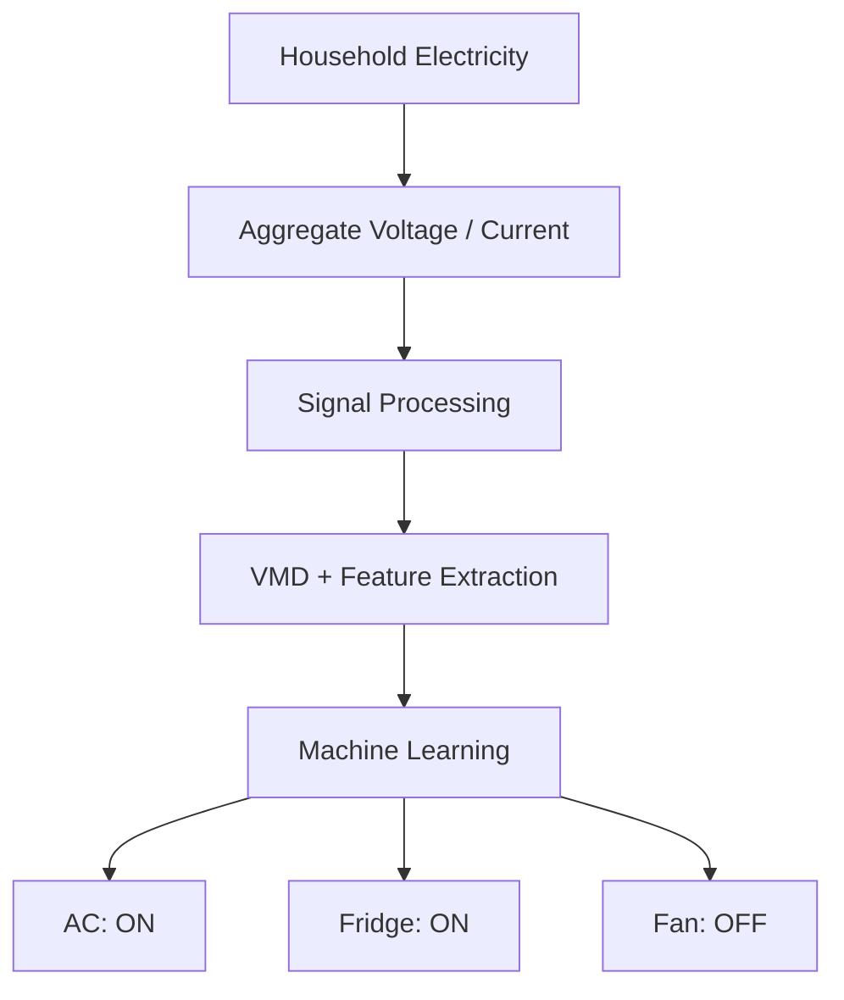

The system therefore has two distinct jobs:

| Stage | Responsibility |
|---|---|
| **Signal processing (VMD)** | Convert the raw electrical waveform into a useful numerical representation |
| **Machine learning (Random Forest)** | Learn the relationship between that representation and appliance ON/OFF states |

> **Central distinction:** VMD does **not** identify the appliance, and Random Forest does **not** perform VMD. The two stages are complementary and operate in sequence.

---

## 2. Sources of Training Data

Different datasets serve different purposes in this project. They are **not** simply concatenated into one giant CSV, because their sampling rates, signal formats, recording environments, and measurement structures differ.

### Dataset Roles at a Glance

| Dataset | Main Role | What We Get |
|---|---|---|
| **PLAID** | Primary VMD experiment | High-frequency voltage + current |
| **iAWE** | Indian-context RF baseline | Mains + appliance-level electrical metrics |
| **HIFDA** | High-frequency validation | High-frequency appliance recordings |
| **Own Data** | Final validation | Raspberry Pi sensor measurements |

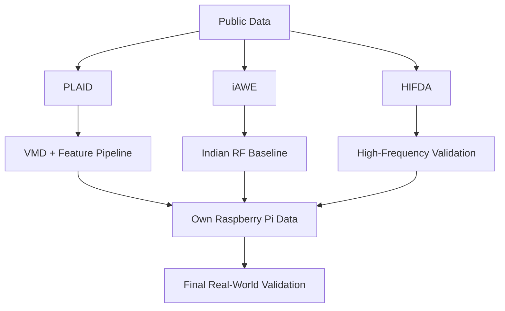

---

### 2.1 PLAID — Primary VMD Dataset

**Full name:** Plug Load Appliance Identification Dataset
**Source:** [PLAID — Figshare](https://figshare.com/articles/dataset/PLAID_-_A_Voltage_and_Current_Measurement_Dataset_for_Plug_Load_Appliance_Identification_in_Households/10084619)

| Property | Details |
|---|---|
| Type | High-frequency electrical dataset |
| Signals | Voltage + current waveforms |
| Approx. sampling rate | ~30 kHz |
| Main use | VMD + feature extraction |
| Project role | Primary high-frequency experiment |
| Main limitation | Non-Indian recording environment |

PLAID provides high-frequency voltage and current recordings of household appliances, making it suitable for testing the part of the pipeline that requires detailed waveform information.

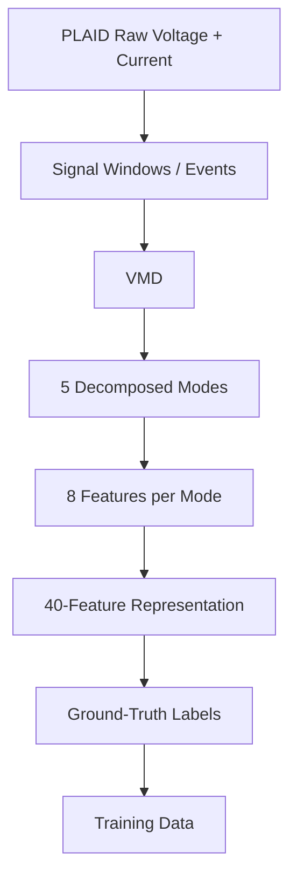

> **Important limitation:** VMD does not automatically identify which mode belongs to which appliance. Also, do not assume every possible simultaneous-appliance combination exists in PLAID — dataset metadata must be inspected before making coverage claims.

---

### 2.2 iAWE — Indian-Context Baseline

**Full name:** Indian Appliance Energy Dataset
**Source:** [iAWE Official Website](https://iawe.github.io/)

| Property | Details |
|---|---|
| Type | Household aggregate + appliance dataset |
| Signals | Computed electrical metrics |
| Environment | New Delhi, India |
| Main use | Indian-context RF baseline |
| Project role | Indian household testing |
| Main limitation | No raw high-frequency waveform |

iAWE is valuable because it provides measurements from an actual Indian household. Relevant appliance channels include:

- Refrigerator
- Air Conditioner
- Washing Machine
- Laptop Computer
- Iron
- Television

Its key limitation is that it provides **already-computed** measurements (`W`, `VAR`, `VA`, `f`, `V`, `PF`, `A`), not raw high-frequency voltage/current waveforms.

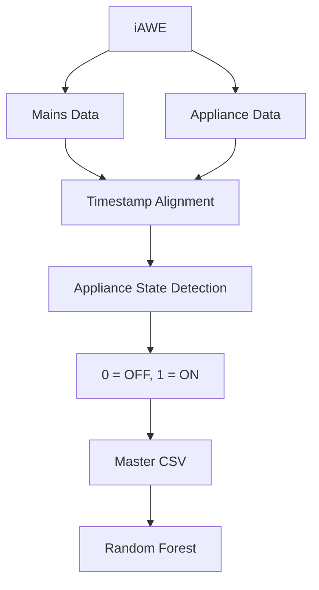

> **What iAWE is not used for:** It is not the primary dataset for raw-waveform VMD testing — it serves as the **Indian-context classification baseline**.

---

### 2.3 HIFDA — High-Frequency Validation

**Full name:** High-Frequency Appliance Dataset
**Source:** [HIFDA — Zenodo](https://zenodo.org/records/14886758)

| Property | Details |
|---|---|
| Type | High-frequency appliance recordings |
| Main use | Waveform characteristic studies |
| Project role | Secondary signal-processing validation |
| Main limitation | Mainly isolated appliance recordings |

HIFDA provides another high-frequency source to check whether the signal-processing and feature-extraction implementation behaves sensibly on different appliance recordings.

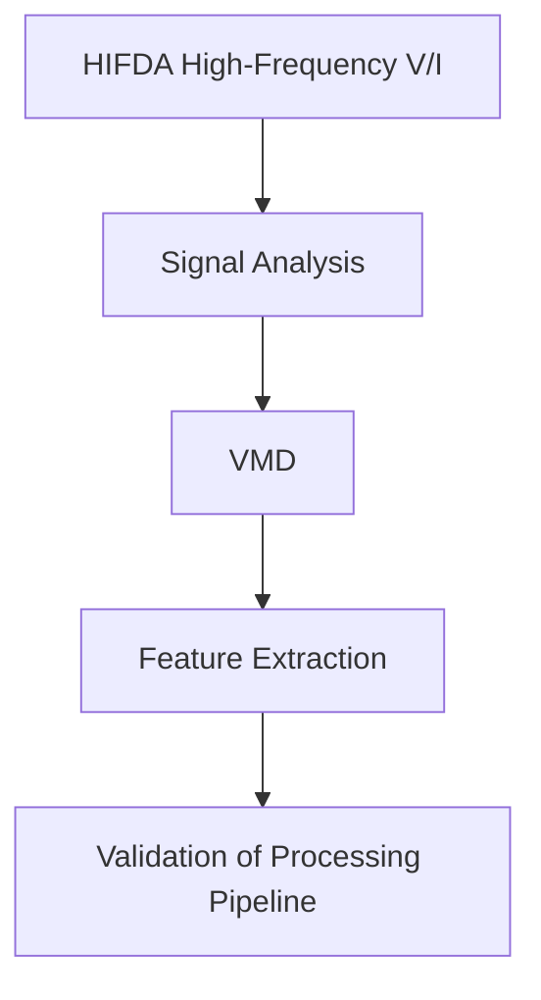

> **Important:** HIFDA is supplementary and should not be treated as a complete whole-house, simultaneous-load dataset.

---

## 3. Why the Datasets Are Not Simply Merged

This is one of the most important decisions in the project: the datasets do not describe electricity in the same way, so blind concatenation is incorrect.

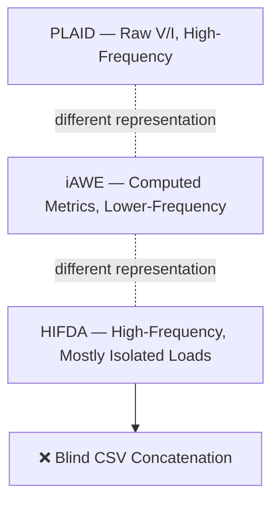

### The Correct Approach: Purpose-Specific Processing

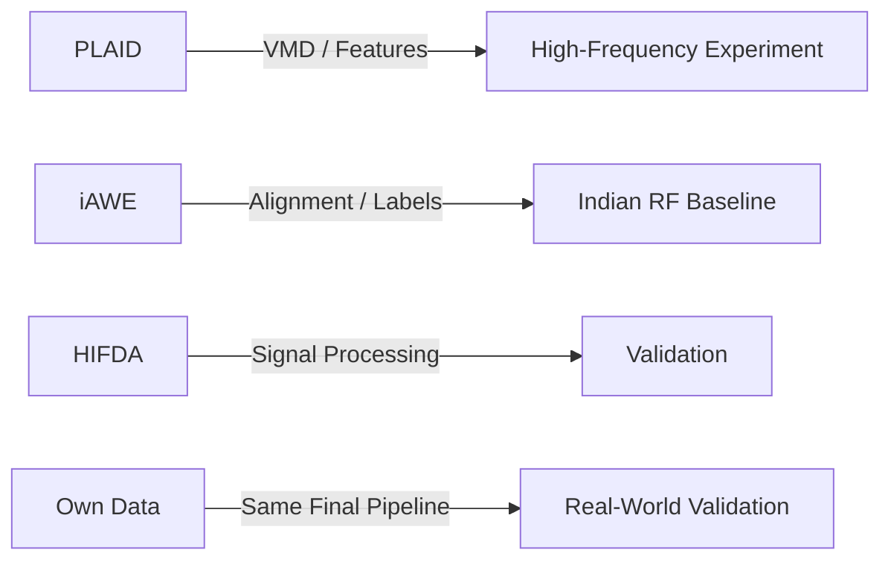

Using multiple datasets means running **purpose-specific pipelines**, not appending every row into one CSV.

---

## 4. From Downloaded Data to Training Data

Downloading a dataset is only the beginning. A machine-learning model needs two things:

- **X** — the features the model sees
- **Y** — the ground-truth labels the model must predict

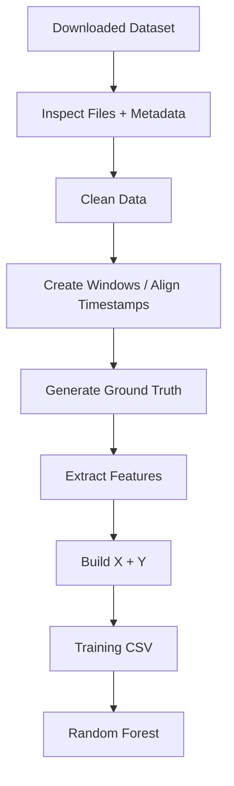

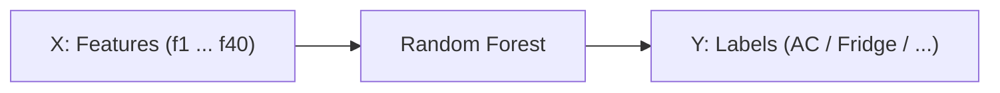

> The model must **never** receive the appliance label as an input feature — the label is the answer it is learning to predict.

---

## 5. iAWE → Master CSV

For iAWE, the key task is combining aggregate measurements with the corresponding appliance states.

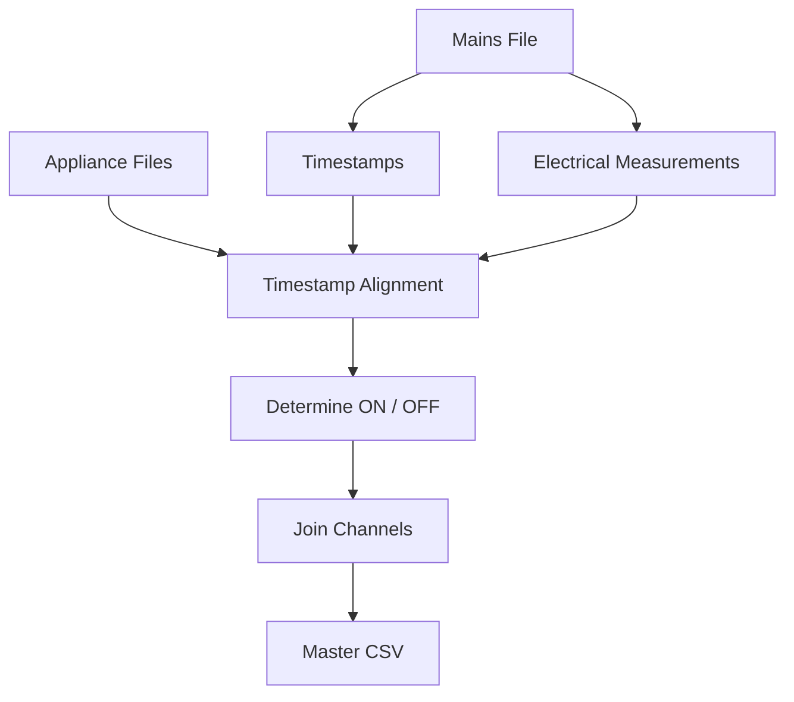

### Example Structure

| timestamp | P | VAR | VA | V | AC | Fridge | Washing Machine | TV |
|---|---:|---:|---:|---:|---:|---:|---:|---:|
| t1 | ... | ... | ... | ... | 0 | 1 | 0 | 1 |
| t2 | ... | ... | ... | ... | 1 | 1 | 0 | 1 |
| t3 | ... | ... | ... | ... | 1 | 0 | 1 | 1 |

- **Left side (P, VAR, VA, V):** input features **(X)**
- **Right side (AC, Fridge, Washing Machine, TV):** ground-truth labels **(Y)**

### Timestamp Alignment

Appliance and aggregate measurements do not necessarily share identical timestamps:

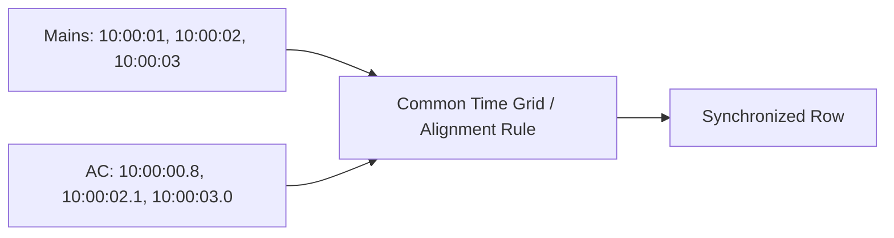

> **Important:** The actual alignment method and tolerance must be determined by inspecting the real iAWE files — do not assume a fixed tolerance in advance. The same principle applies to ON/OFF thresholds: derive them from the appliance data itself rather than choosing arbitrary values.

---

## 6. PLAID → VMD Feature CSV

PLAID follows a different path, since the important information lives in the waveform.

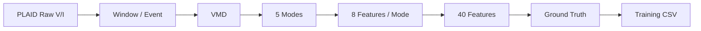

The overall transformation:

**Raw electrical waveform → Signal representation → Numerical features → Machine-learning input**

---

## 7. What VMD Actually Does

**VMD = Variational Mode Decomposition.** It decomposes a signal into several band-limited modes.

Given an aggregate signal $x(t)$, VMD represents it approximately as:

$$x(t) \approx u_1(t) + u_2(t) + u_3(t) + u_4(t) + u_5(t)$$

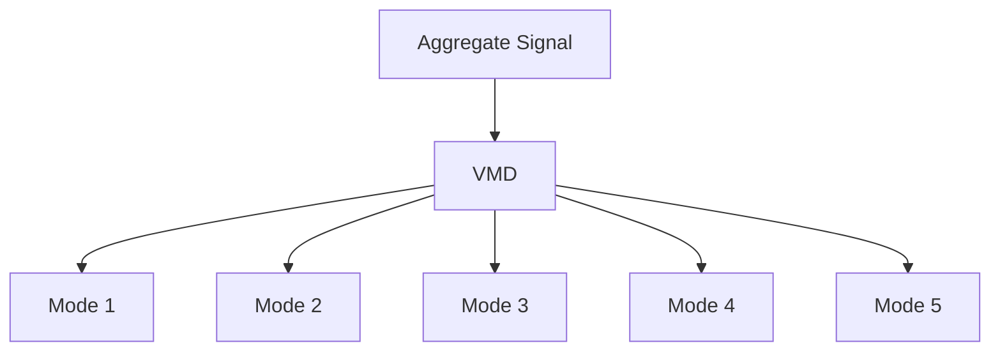

| What VMD Does | What VMD Does NOT Do |
|---|---|
| Produces multiple signal components that can be analyzed separately | Know that "Mode 1 = AC", "Mode 2 = Fridge", "Mode 3 = Fan" |

Appliance identity is learned **later**, from the combined feature representation — never assumed from mode order alone.

---

## 8. From 5 Modes to 40 Features

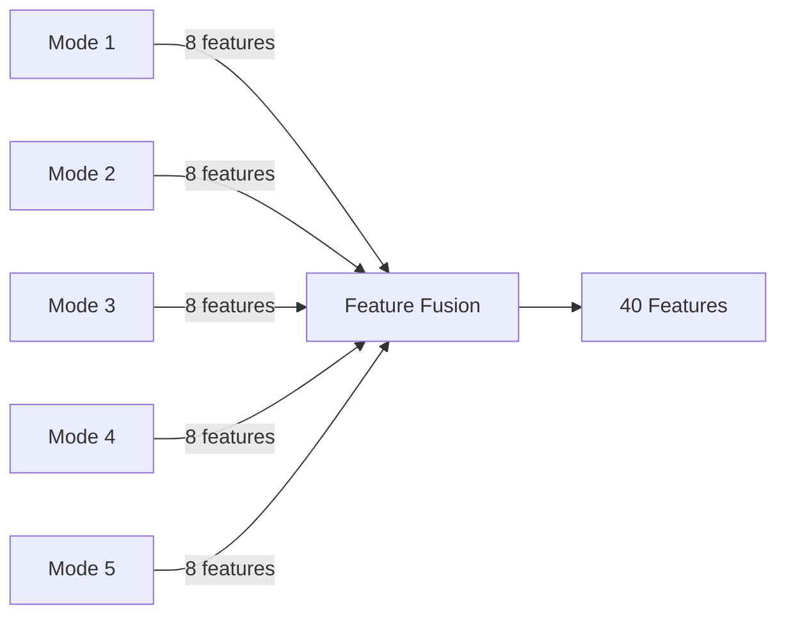

**5 modes × 8 features = 40 features.**

> **Very important:** These are 8 features **per mode**, not 8 features per appliance. The 40-dimensional vector represents information from the decomposed *aggregate* signal. The exact eight features must be defined and validated during implementation, not assumed to be automatically optimal.

### 8.1 Consistent Mode Ordering

VMD mode ordering must be consistent between training and deployment, otherwise a feature such as `mode1_f1` could refer to different signal components in different samples.

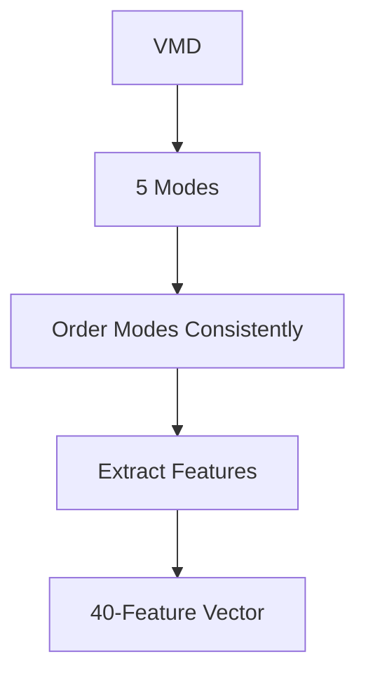

A practical approach is to order modes consistently by **center frequency**.

---

## 9. What Random Forest Actually Learns

A Random Forest consists of many decision trees operating on the 40-feature vector.

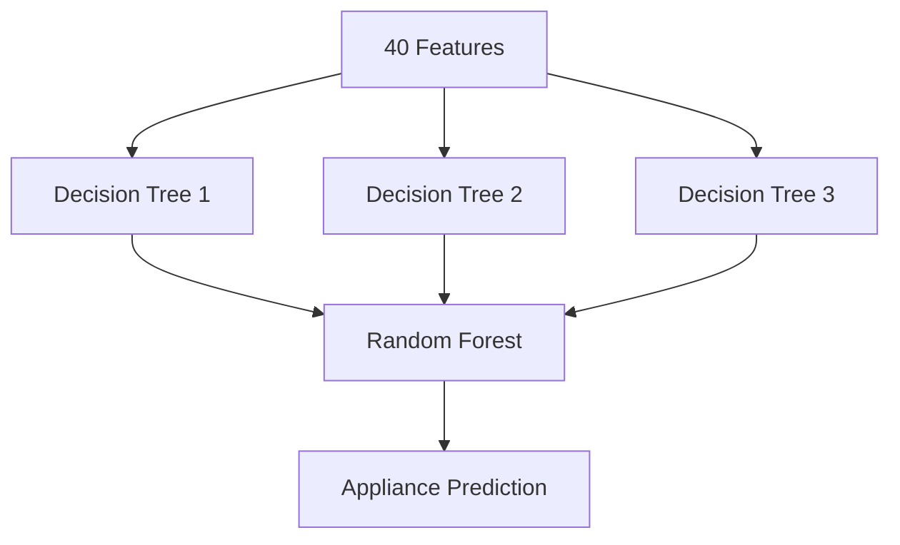

A single tree may effectively learn rules such as:

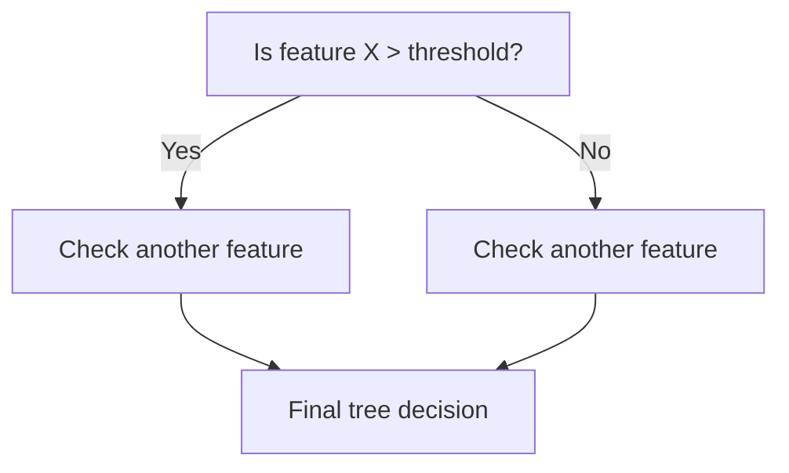

### Crucial Point

Random Forest does **not**:

- directly read raw electrical waveforms
- perform VMD
- magically separate physical appliance sources

It receives the numerical feature vector and learns statistical relationships between those features and the labelled appliance states.

---

## 10. Predicting Multiple Appliances

A real household can have several appliances ON simultaneously, so the output must be **multi-label**.

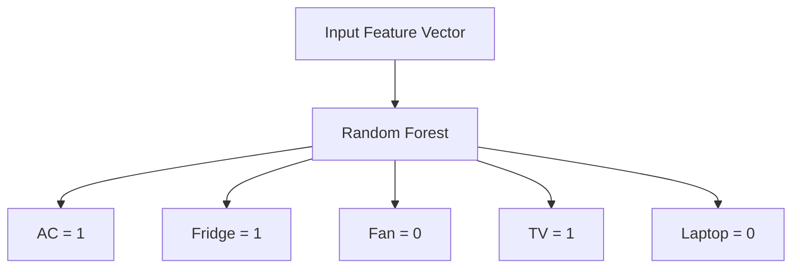

### Example Label Combinations

| Combination | [AC, Fridge, Fan] |
|---|---|
| AC only | [1, 0, 0] |
| Fridge only | [0, 1, 0] |
| AC + Fridge | [1, 1, 0] |
| AC + Fridge + Fan | [1, 1, 1] |

The training data must contain appropriate combinations if the deployed model is expected to recognize simultaneous appliance states.

---

## 11. The Difficult Part — Simultaneous Appliances

This is where true NILM becomes difficult.

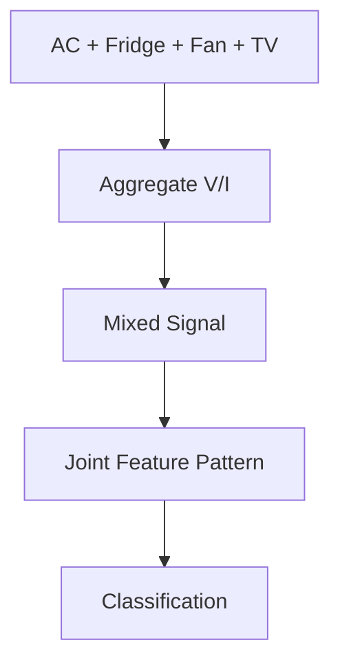

The signal now contains information from several overlapping loads.

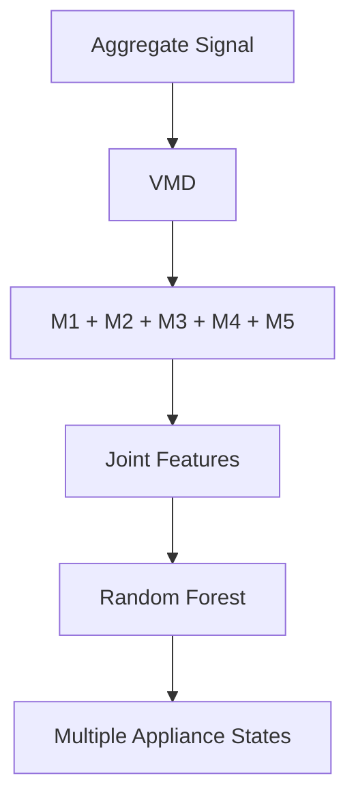

> VMD does **not** guarantee a clean mapping such as M1 = AC, M2 = Fridge, M3 = Fan. The model must learn from appropriate mixed-load examples. If the electrical measurements do not contain enough information to distinguish two states, no classifier can recover information that was never measured.

---

## 12. Complete Training Pipeline

```mermaid
flowchart TD
    A[Dataset] --> B[Cleaning / Alignment]
    B --> C[Signal Windows]
    C --> D[VMD]
    D --> E[5 Modes]
    E --> F[8 Features per Mode]
    F --> G[40-Feature Vector]
    G --> H[Feature Matrix X]

    B --> I[Ground-Truth Labels Y]

    H --> J[Train / Validation / Test Split]
    I --> J
    J --> K[Multi-Output Random Forest]
    K --> L[Predictions]
    L --> M[Evaluation]
    M --> N[Saved Model]
```

---

## 13. Structure of the Training CSV

The final tabular representation is conceptually:

| sample_id | timestamp | mode1_f1...mode1_f8 | mode2_f1...mode2_f8 | mode3_f1...mode3_f8 | mode4_f1...mode4_f8 | mode5_f1...mode5_f8 | AC | Fridge | Fan | TV | Laptop | Washing Machine |
|---|---|---|---|---|---|---|---|---|---|---|---|---|

```mermaid
flowchart LR
    subgraph X [Feature Side — X]
    A["mode1_f1 ... mode5_f8"]
    end
    subgraph Y [Label Side — Y]
    B["AC | Fridge | Fan | TV | Laptop | Washing Machine"]
    end
```

| | X — Input Features | Y — Ground Truth |
|---|---|---|
| **Contents** | 40 electrical features | Appliance ON/OFF states |

---

## 14. Training Pipeline vs Deployment Pipeline

> **Most important deployment principle:** Training and deployment must produce the **same** feature representation.

```mermaid
flowchart TD
    subgraph Training
    A1[Public Dataset] --> A2[Preprocessing]
    A2 --> A3[VMD]
    A3 --> A4[5 Modes]
    A4 --> A5[40 Features]
    A5 --> A6[Random Forest Training]
    A6 --> A7[Saved Model]
    end

    subgraph Deployment["Real Device"]
    B1["SCT-013 + ZMPT101B"] --> B2[Signal Conditioning]
    B2 --> B3[ADC]
    B3 --> B4[Raspberry Pi]
    B4 --> B5[Synchronized V/I]
    B5 --> B6[Same Preprocessing]
    B6 --> B7[Same VMD]
    B7 --> B8[Same 40 Features]
    B8 --> B9[Saved Random Forest]
    B9 --> B10[Appliance ON/OFF]
    end
```

The representation must remain consistent across:

- preprocessing
- VMD parameters
- mode ordering
- feature definitions and order
- scaling / normalization
- model input format

---

## 15. From Real Sensors to the Raspberry Pi

The sensor output is not a ready-made digital feature vector — it must pass through several stages first.

```mermaid
flowchart TD
    A[Household Mains] --> B["SCT-013 (Current Sensor)"]
    A --> C["ZMPT101B (Voltage Sensor)"]
    B --> D[Signal Conditioning]
    C --> D
    D --> E[ADC]
    E --> F[Raspberry Pi]
    F --> G[Synchronized V/I]
    G --> H[VMD]
```

> The exact ADC and analog front-end must be selected and validated during hardware implementation.

---

## 16. Limitations and Failure Cases

### ⚠️ VMD Limitation
VMD decomposes a signal into modes; it does **not** guarantee clean physical separation of appliances.

### ⚠️ Simultaneous-Load Limitation

```mermaid
flowchart LR
    A["AC + Fridge + Fan"] --> B[Mixed Signal] --> C[Harder Classification]
```

The model must be evaluated on realistic simultaneous-load data.

### ⚠️ Dataset Limitation
A model trained on public datasets may perform differently on our own Indian household measurements because of:

- different appliances
- different sensors
- different electrical conditions
- different recording environments
- different noise characteristics

### ⚠️ Sampling Limitation
Higher sampling frequency provides more waveform information, but a higher sampling rate alone does **not** guarantee perfect appliance separation. Sensor bandwidth, ADC quality, synchronization, noise, and feature extraction quality all matter.

### ⚠️ Ground-Truth Limitation
Machine-learning quality depends on correct labels. Incorrect timestamp alignment or incorrect ON/OFF labels can teach the model the wrong relationship.

---

## 17. Data Leakage — An Evaluation Risk

Suppose one physical recording is split into many nearly identical windows:

```mermaid
flowchart TD
    A[One Recording] --> B[100 Similar Windows]
    B --> C["90 → Train"]
    B --> D["10 → Test"]
```

This can produce artificially high test performance, since test windows closely resemble training windows.

### Better Approach — Split by Recording/Session

```mermaid
flowchart LR
    A[Recording / Session A] --> T[Train]
    B[Recording / Session B] --> V[Validation]
    C[Recording / Session C] --> S[Test]
```

The model should be evaluated on recordings it did not effectively see during training.

### Evaluation Metrics

- Accuracy
- Precision
- Recall
- F1-score
- Per-appliance metrics
- Confusion matrix (where appropriate)

> Do not treat a target accuracy as a guaranteed result.

---

## 18. Final System Architecture

Only after understanding the complete pipeline do we combine everything into the final architecture.

```mermaid
flowchart TD
    A[Household Mains] --> B["SCT-013 (Current Sensor)"]
    A --> C["ZMPT101B (Voltage Sensor)"]

    B --> D[Signal Conditioning]
    C --> D

    D --> E[ADC]
    E --> F[Raspberry Pi]
    F --> G[Synchronized V/I]
    G --> H[Preprocessing]
    H --> I[VMD]
    I --> J[5 VMD Modes]
    J --> K[8 Features / Mode]
    K --> L[40-Feature Vector]
    L --> M[Multi-Output Random Forest]

    M --> N[AC]
    M --> O[Fridge]
    M --> P[Fan]
    M --> Q[Washing Machine]
    M --> R[TV]
    M --> S[Laptop]

    N --> T[ON / OFF States]
    O --> T
    P --> T
    Q --> T
    R --> T
    S --> T

    T --> U[Backend / Dashboard]
```

*(This diagram is intentionally the most detailed one in the document, since it represents the complete system. Earlier diagrams remain concept-specific by design.)*

---

## 19. Final Project Strategy

| Phase | Dataset / Data | Goal |
|---|---|---|
| **Phase 1** | PLAID | VMD + feature pipeline |
| **Phase 2** | iAWE | Indian-context RF baseline |
| **Phase 3** | HIFDA | High-frequency validation |
| **Phase 4** | Own Raspberry Pi data | Final real-world validation |

```mermaid
flowchart TD
    A[Public Data] --> B[Prove the Pipeline]
    B --> C[Train Random Forest]
    C --> D[Validate]
    D --> E[Collect Own Data]
    E --> F[Run Same Pipeline]
    F --> G[Real NILM System]
```

---

## 20. Summary — The Complete Idea

```mermaid
flowchart TD
    A[Datasets] --> B[PLAID]
    A --> C[iAWE]
    A --> D[HIFDA]

    B --> E[VMD]
    C --> F[RF Baseline]
    D --> G[Validation]

    E --> H[5 Modes]
    H --> I[8 Features / Mode]
    I --> J[40 Features]
    J --> K["X"]
    K --> L[Random Forest]
    L --> M["Y"]

    M --> N["AC = 1"]
    M --> O["Fridge = 1"]
    M --> P["Fan = 0"]
```

### Final Principle

| Concept | Meaning |
|---|---|
| **VMD** | Signal decomposition / representation |
| **Random Forest** | Learning the feature → appliance-state relationship |
| **Multi-label output** | Multiple appliances can be ON together |

The final goal is to carry the same, carefully validated pipeline from public data all the way to real Raspberry Pi measurements:

```mermaid
flowchart TD
    A[Public Data] --> B[Validated Processing]
    B --> C[Validated Features]
    C --> D[Trained Random Forest]
    D --> E[Raspberry Pi Sensor Data]
    E --> F[Same Processing]
    F --> G[Same 40-Feature Representation]
    G --> H[Appliance ON/OFF Prediction]
```
